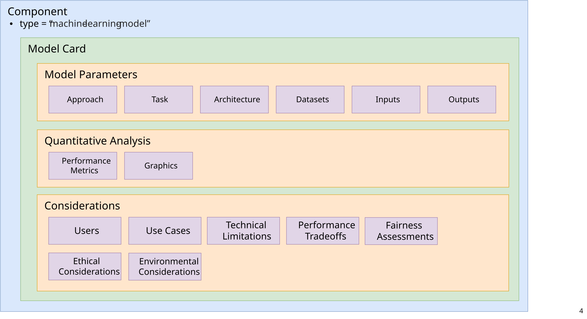
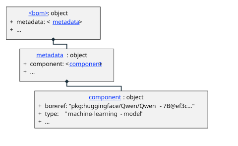
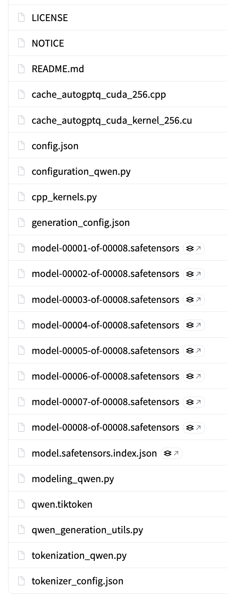

# AI/ML-BOM Design and Best Practices

## Overview

An AI/ML Bill-of-Materials (AI/ML-BOM) is an object model to describe a machine learning model, its compositional assets, and other descriptive information often used to assess risk and compliance. Support for AI/ML-BOM was introduced in CycloneDX v1.5; this guide describes AI/ML-BOMs using CycloneDX v2.0.

An AI/ML-BOM relies on many of the common, core elements of the CycloneDX schema, as well as unique aspects specific to ML components, their architectures, metadata, training, and other information used to gauge regulatory compliance.

This guide will provide specifics and best practices for conveying ML-related information using the CycloneDX schema.

The [Core Concepts](0x15-Core-Concepts.md#key-components-of-an-aiml-bom) listed in the previous section will be used to provide details, best practices, and examples for providing the corresponding information using CycloneDX schema objects.

For convenience, here are links to the specific sections for each of those informational areas:

* [Anatomy of an AI/ML-BOM](#anatomy-of-an-aiml-bom)
* [Declaring ML Models](#declaring-ml-models)
  * [Describing models as components](#describing-models-as-components)
  * [Model repositories as components](#model-repositories-as-components)
  * [Model identifiers](#model-identifiers)
  * [Providing model release notes](#providing-model-release-notes)
  * [Describing a model repository as a CycloneDX assembly](#describing-a-model-repository-as-a-cyclonedx-assembly)
  * [Declaring a model's pedigree](#declaring-a-models-pedigree)

<div style="page-break-after: always; visibility: hidden">
\newpage
</div>

## Anatomy of an AI/ML-BOM

In CycloneDX, a model is considered a `component` where general best practices for providing information such as component identification, metadata, provenance, pedigree, etc. should be followed as documented in the [CycloneDX Authoritative Guide to SBOM](https://cyclonedx.org/guides/OWASP_CycloneDX-Authoritative-Guide-to-SBOM-en.pdf).



<!-- TODO(2.0): update anatomy.svg for 2.0 (inventories/subject, modelProperties, measurements, parties, risks, definitions.useCases, perspectives) -->

The CycloneDX 2.0 schema is modular. The objects most relevant to an AI/ML-BOM are:

| CycloneDX 2.0 object | Purpose in an AI/ML-BOM |
|---|---|
| `inventories[].subject` | The model being described by the AI/ML-BOM (the BOM's "subject" component) |
| `inventories[].components` | The constituent components of the model (e.g., files in the model repository, tokenizers, datasets) |
| `component.parties` | The organizations, people, systems, and personas related to the model, each with one or more `roles` |
| `component.identifiers` | Identities (e.g., `purl`) for the model, each asserted by a referenced party |
| `component.modelProperties` | AI/ML-specific properties: tasks, learning types, architecture, parameter count, quantization, inputs, outputs, training, and limitations |
| `component.measurements` | Performance metrics (quantitative analysis) and energy consumption (environmental considerations) |
| `definitions` | Shared, referenceable objects such as `components`, `parties`, and `useCases` |
| `risks` | Ethical, fairness, and other risks attributed to the model, including their impacts and responses |
| `perspectives` | Views that map AI/ML-BOM data into the terms of a particular audience, such as a "Model Card" |

> **CycloneDX 1.7 → 2.0**: The 1.7 `metadata.component` is replaced by `inventories[].subject`, `bom-ref` is replaced by `refId`, and the 1.7 `modelCard` object is replaced by `modelProperties`, `measurements`, `parties`, `definitions.useCases`, and `risks`.

## Declaring ML models

### Describing models as components

A model should always be declared as a CycloneDX `component`.  If the model itself is the subject of the BOM, then the BOM is considered an AI/ML-BOM, and the `component` representing it would be declared as the `subject` of an entry in the top-level BOM `inventories` array.

The object model's pseudo-schema would look something like this:


<!-- TODO(2.0): replace ml-bom-metadata-component.svg with an inventories/subject diagram -->

> **Note** In all example JSON pseudo-code, lines with: "// ..." indicate that additional fields or elements may be added at this position. This is a documentation placeholder and is not valid JSON; it would not appear in actual implementations.

###### Example: Declaring an ML model in an AI/ML-BOM

The CycloneDX JSON pseudocode below shows how an ML model would be declared as the "subject" `component` of an AI/ML-BOM within the top-level `inventories` array:

```json
{
  "$schema": "https://cyclonedx.org/schema/2.0/cyclonedx-2.0.schema.json",
  "specFormat": "CycloneDX",
  "specVersion": "2.0",
  "serialNumber": "urn:uuid:ec45525e-516c-4405-9de3-4fbdaef7f09a",
  "version": 1,
  "inventories": [
    {
      "subject": {
        "type": "machine-learning-model",
        "refId": "pkg:huggingface/Qwen/Qwen-7B@ef3c5c9",
        "name": "Qwen/Qwen-7B",
        "version": "ef3c5c9c57b252f3149c1408daf4d649ec8b6c85",
        "licenses": [
          {
            "license": {
              "name": "Tongyi Qianwen LICENSE AGREEMENT",
              "text": {
                "content": "By clicking to agree or by using or distributing any portion or element of the Tongyi Qianwen Materials, ..."
              }
            }
          }
        ]
        // ...
      },
      "components": [
        // ...
      ]
    }
  ]
  // ...
}
```

###### Field discussion

* **inventories** - Each inventory declares one `subject` and the `components` that it includes. An AI/ML-BOM describing a single model has a single inventory whose `subject` is the model.
* **refId** - The `refId` uniquely identifies the component within the BOM so it may be referenced elsewhere (e.g., from `dependencies`, `compositions`, or `risks`). Please note the `refId` value includes the first seven characters of the larger commit hash, which is sufficient for local identification within the BOM itself.
* **license** - The `licenses` object shown in the example is a "custom" license which, in this case, we chose to provide the unencoded license text.  It is preferable, when possible to use an [SPDX license identifier](https://spdx.org/licenses/) and supply it in the `id` field of the `license` (e.g., `"license": { "id": "Apache-2.0" }` ).

#### Model repositories as components

When referencing an ML model as a component, it typically means you are referencing a **model repository** comprised of metadata and a set of files (e.g., pre-trained tensor data in various formats, model configurations, tokenizers, tokenizer configurations, prompt templates, Python code, etc.) which would be selectively used with various, compatible AI or ML applications and frameworks.

If possible, these model repositories should be treated as a software "package" in a Software Bill of Materials (SBOM) when declaring them as `machine-learning-model` type CycloneDX components.

###### Example: CycloneDX for the Qwen-7B model repository

The following example shows how the Hugging Face [Qwen/Qwen-7B](https://huggingface.co/Qwen/Qwen-7B) model repository would be declared as a CycloneDX `component` of type `machine-learning-model` in a CycloneDX AI/ML-BOM as its subject component.

Since the model repository is hosted on Hugging Face, the [Huggingface package type](https://github.com/package-url/purl-spec/blob/main/types/huggingface-definition.json) of the [Package URL specification](https://github.com/package-url/purl-spec) may be used to identify the model.

```json
{
  "$schema": "https://cyclonedx.org/schema/2.0/cyclonedx-2.0.schema.json",
  // ...
  "inventories": [
    {
      "subject": {
        "type": "machine-learning-model",
        "refId": "pkg:huggingface/Qwen/Qwen-7B@ef3c5c9",
        "group": "Qwen",
        "name": "Qwen/Qwen-7B",
        "version": "ef3c5c9c57b252f3149c1408daf4d649ec8b6c85",
        "description": "Qwen-7B is a Transformer-based large language model, which is pretrained on a large volume of data, including web texts, books, codes, etc.",
        "parties": [
          {
            "refId": "party-alibaba-cloud",
            "roles": [ { "role": "manufacturer" } ],
            "organization": {
              "name": "Alibaba Cloud",
              "url": [ { "url": "https://www.alibabacloud.com" } ]
            }
          },
          {
            "refId": "party-hugging-face",
            "roles": [ { "role": "supplier" } ],
            "organization": {
              "name": "Hugging Face",
              "url": [ { "url": "https://huggingface.co" } ]
            }
          }
        ],
        "identifiers": [
          {
            "party": "party-hugging-face",
            "identities": [
              {
                "scheme": "purl",
                "value": "pkg:huggingface/Qwen/Qwen-7B@ef3c5c9c57b252f3149c1408daf4d649ec8b6c85"
              }
            ]
          }
        ],
        "externalReferences": [
          {
            "type": "vcs",
            "url": "https://huggingface.co/Qwen/Qwen-7B"
          },
          {
            "type": "model-card",
            "url": "https://huggingface.co/Qwen/Qwen-7B"
          }
        ],
        "modelProperties": {
          // ...
        }
      },
      "components": [
        // ...
      ]
    }
  ]
}
```

###### Field discussion

This section provides best practice guidance on how the component fields were filled out for this example.

- **refId** - Since a PURL is available, it can also be used as the `refId`.
- **group** - In this example, we chose to include the optional group field to acknowledge the specific model repository is part of the Qwen family of models.
- **name** - The model name reflects how the model is identified under Hugging Face using the `<owner_name>/<repository_name>` format.
- **version** - Models are not always versioned in the way software packages are (e.g., using `semver` format); however, within repositories such as Huggingface, the version is determined by its version control system's *commit hash*, *tag*, or *branch*. In the above example, the model's commit hash matches the version in the `purl` identity.
- **parties** - Declares the organizations involved with the model and the role(s) each plays.
  - **manufacturer** - The company which built the Qwen model (Alibaba Cloud).
  - **supplier** - The organization that supplies (distributes) the model repository (Hugging Face).
- **identifiers** - Groups one or more identities by the party that asserts them. Here, the party referenced by `party-hugging-face` asserts the model's identity as a Package URL (PURL) using the [Huggingface package type](https://github.com/package-url/purl-spec/blob/main/types/huggingface-definition.json) with a commit hash.
- **externalReferences** - Used to provide unambiguous links to component's model repository and originating model card.
  - **vcs** - Provides a link to the version control system (i.e., the model repository hosted by the `supplier`). In this example, the Hugging Face repository is used to affirm the associated PURL identifier.
  - **model-card** - Provides a link to the model's Hugging Face model card which is comprised of mostly unstructured information in the form of a markdown file (i.e., README.md).</br>*The CycloneDX representation of model card information will be detailed in a subsequent section.
- **modelProperties** - Holds the AI/ML-specific information about the model (e.g., tasks, architecture, inputs, outputs, training data, and limitations). This replaces the CycloneDX 1.x `modelCard` object and is described in subsequent sections.

> **CycloneDX 1.7 → 2.0**: The 1.7 `manufacturer`, `supplier`, and `publisher` fields on a component are replaced by entries in the component's `parties` array, each with the corresponding `role`. The 1.7 `purl` and `cpe` fields are replaced by `identities` within `identifiers`, using the `purl` and `cpe` schemes.

#### Model identifier(s)

As you can see in the above example, the `component` has a `refId` that is also a valid [Package URL (PURL)](https://github.com/package-url/purl-spec) for a ["Qwen-7B" model hosted in a Huggingface model repository](https://huggingface.co/Qwen/Qwen-7B) using the [Hugging Face PURL type](https://github.com/package-url/purl-spec/blob/main/types-doc/huggingface-definition.md). When a valid `purl` identity is available for a model, it is recommended that it (or a shortened form of it) also be used as its component's `refId`.

If the model being described by an AI/ML-BOM is instead hosted in a GitHub repository, it can also be referenced using a [GitHub Package URL](https://github.com/package-url/purl-spec/blob/main/types-doc/github-definition.md). For example, the ONNX vision model: [tiny-yolov2](https://github.com/onnx/models/tree/main/validated/vision/object_detection_segmentation/tiny-yolov2/model) would have a `github` PURL type.

###### Example: JSON for model component with GitHub PURL

 **Note**: The derivative `refId`, based upon the PURL, is also shown.

```json
{
  "type": "machine-learning-model",
  "refId": "pkg:github/onnx/models@4c46cd0#tiny-yolov2/model",
  "name": "tiny-yolov2",
  "parties": [
    {
      "refId": "party-onnx",
      "roles": [ { "role": "publisher" } ],
      "organization": { "name": "ONNX" }
    }
  ],
  "identifiers": [
    {
      "party": "party-onnx",
      "identities": [
        {
          "scheme": "purl",
          "value": "pkg:github/onnx/models@4c46cd00fbdb7cd30b6c1c17ab54f2e1f4f7b177#validated/vision/object_detection_segmentation/tiny-yolov2/model"
        }
      ]
    }
  ]
  // ...
}
```

##### Adding domain-specific identifiers

Organizations that produce BOMs for hardware or software components they produce may have multiple domain-specific identifiers for the same component.  In CycloneDX 2.0, these can be declared as additional identities asserted by the organization, using a predefined identity `scheme` (e.g., `model-number`, `part-number`, `sku`) or a custom scheme with a `name` and `description`.

###### Example: domain-specific identifiers

The following example shows how a fictional company, ACME, could assert an internal identifier for one of its ML models alongside its PURL.

```json
{
  "type": "machine-learning-model",
  "name": "acme-research-llm",
  // ...
  "parties": [
    {
      "refId": "party-acme",
      "roles": [ { "role": "manufacturer" } ],
      "organization": { "name": "ACME" }
    }
  ],
  "identifiers": [
    {
      "party": "party-acme",
      "identities": [
        {
          "scheme": "purl",
          "value": "pkg:generic/acme/acme-research-llm@1.0.0"
        },
        {
          "scheme": {
            "name": "acme:research:model:llm:id",
            "description": "ACME Research internal LLM registry identifier"
          },
          "value": "MODEL-ID-12345-INTERNAL"
        }
      ]
    }
  ]
}
```

> **Note**: Where an identifier does not fit the `identifiers` structure, organizations may still register (reserve) an official namespace with the [CycloneDX Property Taxonomy](https://github.com/CycloneDX/cyclonedx-property-taxonomy), which is the authoritative source of official namespaces used in CycloneDX `properties`, and provide the value as a property (e.g., `"name": "acme:research:model:llm:id"`).

##### Identifying a specific model quantization

Some model repositories may contain different [quantizations](0x90-Appendix-A_Glossary.md#quantization) to choose from, which optimize for different target inference runtimes and hardware footprints.

In general, these are referenceable as (often single) files within a model repository, each of which can be described as a CycloneDX component, as shown in the next section [Describing a model repository as a CycloneDX assembly](#describing-a-model-repository-as-a-cyclonedx-assembly).

###### Example: Qwen/Qwen3-8B-GGUF

This example uses the model repository [Qwen/Qwen3-8B-GGUF](https://huggingface.co/Qwen/Qwen3-8B-GGUF), which contains several quantizations of the Qwen3-8B model (published originally in a non-quantized format elsewhere) in [GGUF format](0x90-Appendix-A_Glossary.md#gguf-gpt-generated-unified-format).

These quantized GGUF models are each individual files in the repository:

* Qwen3-8B-Q4_K_M.gguf
* Qwen3-8B-Q5_0.gguf
* Qwen3-8B-Q6_K.gguf
* Qwen3-8B-Q8_0.gguf

Each can be specifically identified in a CycloneDX component using a Package URL (PURL). For example, the `Qwen3-8B-Q4_K_M.gguf` model would be declared as follows:

```json
{
  "$schema": "https://cyclonedx.org/schema/2.0/cyclonedx-2.0.schema.json",
  "specFormat": "CycloneDX",
  "specVersion": "2.0",
  "serialNumber": "urn:uuid:1ad676cb-6b40-4068-ae91-ebd1533dbf58",
  "version": 1,
  // ...,
  "inventories": [
    {
      "subject": {
        "type": "machine-learning-model",
        "refId": "pkg:huggingface/Qwen/Qwen3-8B-GGUF@7c41481",
        "name": "Qwen/Qwen3-8B-GGUF"
        // ...
      },
      "components": [
        {
          "type": "machine-learning-model",
          "refId": "pkg:huggingface/Qwen/Qwen3-8B-GGUF@7c41481#Qwen3-8B-Q4_K_M.gguf",
          "name": "Qwen3-8B-Q4_K_M.gguf",
          "version": "7c41481f57cb95916b40956ab2f0b139b296d974",
          "identifiers": [
            {
              "party": "party-hugging-face",
              "identities": [
                {
                  "scheme": "purl",
                  "value": "pkg:huggingface/Qwen/Qwen3-8B-GGUF@7c41481f57cb95916b40956ab2f0b139b296d974#Qwen3-8B-Q4_K_M.gguf"
                }
              ]
            }
          ],
          "modelProperties": {
            "quantization": {
              "method": "k-quant",
              "bits": 4
            }
            // ...
          }
          // ...
        }
      ]
    }
  ],
  "definitions": {
    "parties": [
      {
        "refId": "party-hugging-face",
        "roles": [ { "role": "supplier" } ],
        "organization": { "name": "Hugging Face" }
      }
    ]
  }
  // ...
}
```

###### Field discussion

* **type** - The type has the value `machine-learning-model` since the single file contains all the information (e.g., default configuration parameters, references to architectures and tokenizers, prompt template, etc.) needed to run the model in GGUF inference frameworks.
* **modelProperties.quantization** - Describes the quantization applied to the model file. Here, the `Q4_K_M` file uses the GGUF "k-quant" method at (nominally) 4 bits.
* **definitions.parties** - A party referenced from many components (here, Hugging Face as the asserting party for each file's PURL) can be declared once in the BOM's `definitions` and referenced by its `refId`.

##### Providing model release notes

It is important to disclose information regarding a model's release.  This is accomplished by utilizing the CycloneDX component's `releaseNotes` object and its fields.

<div style="page-break-after: always; visibility: hidden">
\newpage
</div>

###### Example: release notes

```json
{
  "$schema": "https://cyclonedx.org/schema/2.0/cyclonedx-2.0.schema.json",
  // ...
  "inventories": [
    {
      "subject": {
        "type": "machine-learning-model",
        "refId": "pkg:huggingface/Qwen/Qwen-7B@ef3c5c9",
        "name": "Qwen/Qwen-7B",
        // ...
        "releaseNotes": {
          "type": "major",
          "title": "Qwen 7B initial release",
          "timestamp": "2023-08-03T15:30:00Z",
          "notes": [
            {
              "locale": "en-US",
              "text": {
                "content": "United States (US), English release date."
              }
            }
            // ...
          ]
        }
      },
      "components": [
        // ...
      ]
    }
  ]
}
```

###### Field discussion

* **type** - The release type (e.g., `major`, `minor`, `patch`, `pre-release`, `internal`) indicates the significance of the model release.
* **notes** - Each note's `text` is an attachment object whose `content` provides the note, optionally per `locale`.

> **Tip**: Release notes shared by several components (e.g., all quantizations of one model release) can be declared once in `definitions.releaseNotes` and referenced from each component.

#### Describing a model repository as a CycloneDX assembly

CycloneDX allows for declarations of software compositions (e.g., hardware products, software applications, packages, libraries, archives, etc.).

In the case of a model repository like those hosted in Hugging Face, one can describe the files that comprise it as a composition with an AI/ML-BOM.  Specifically, it would be declared as a composition of an assembly type.

Specifically, a `component` entry would be created for each file and declared in the AI/ML-BOM's inventory `components` array, then the completeness of that assembly would be asserted within the BOM's `compositions` array using a composition of `kind` `components` whose `targets` reference the `refId` of the model component.

<div style="page-break-after: always; visibility: hidden">
\newpage
</div>

###### Example: Qwen/Qwen-7B model repository files

If we look inside the repository for the [Qwen/Qwen-7B model in Huggingface](https://huggingface.co/Qwen/Qwen-7B), we see the complete list of files that make up the "model" in its repository:



###### CycloneDX for the Qwen/Qwen-7B assembly

The simplified JSON below shows how to declare a few files from the model repository's complete file list as the `components` of the inventory whose `subject` is the model.

> **Note**: In the JSON below, we use the Package URL (PURL) syntax to provide the additional path (with the model repository or "package") to each individual file by appending it using the `#` hash symbol as a separator.  Also, notice that the commit hash (identifier) varies per file.

```json
{
  "$schema": "https://cyclonedx.org/schema/2.0/cyclonedx-2.0.schema.json",
  // ...,
  "inventories": [
    {
      "subject": {
        "type": "machine-learning-model",
        "refId": "pkg:huggingface/Qwen/Qwen-7B@ef3c5c9",
        "name": "Qwen/Qwen-7B"
        // ...
      },
      "components": [
        {
          "type": "file",
          "name": "config.json",
          "description": "Model configuration file using the 'QWenLMHeadModel' model class in Hugging Face Transformers",
          "refId": "pkg:huggingface/Qwen/Qwen-7B@e7a368b#config.json",
          "identifiers": [
            {
              "party": "party-hugging-face",
              "identities": [
                {
                  "scheme": "purl",
                  "value": "pkg:huggingface/Qwen/Qwen-7B@e7a368b0774370edec29674e7c51f52fc7663f59#config.json"
                }
              ]
            }
          ]
          // ...
        },
        {
          "type": "file",
          "name": "configuration_qwen.py",
          "description": "Python 'QWenConfig' class implementation for the Qwen-7B model using Hugging Face Transformers",
          "refId": "pkg:huggingface/Qwen/Qwen-7B@a6ca629#configuration_qwen.py",
          "identifiers": [
            {
              "party": "party-hugging-face",
              "identities": [
                {
                  "scheme": "purl",
                  "value": "pkg:huggingface/Qwen/Qwen-7B@a6ca629d063f56f34d184852301e8852a7afbd58#configuration_qwen.py"
                }
              ]
            }
          ]
          // ...
        },
        {
          "type": "data",
          "name": "model-00001-of-00008.safetensors",
          "description": "Model tensor data (01 of 08)",
          "refId": "pkg:huggingface/Qwen/Qwen-7B@abcb6d6#model-00001-of-00008.safetensors",
          "identifiers": [
            {
              "party": "party-hugging-face",
              "identities": [
                {
                  "scheme": "purl",
                  "value": "pkg:huggingface/Qwen/Qwen-7B@abcb6d6d8ec63ce606f816e2d08072da6309f965#model-00001-of-00008.safetensors"
                }
              ]
            }
          ],
          "data": [
            {
              "type": "dataset",
              "contents": {
                "url": "https://huggingface.co/Qwen/Qwen-7B/blob/main/model-00001-of-00008.safetensors"
              }
            }
          ]
          // ...
        },
        {
          "type": "data",
          "name": "model-00002-of-00008.safetensors",
          "description": "Model tensor data (02 of 08)",
          "refId": "pkg:huggingface/Qwen/Qwen-7B@abcb6d6#model-00002-of-00008.safetensors",
          "identifiers": [
            {
              "party": "party-hugging-face",
              "identities": [
                {
                  "scheme": "purl",
                  "value": "pkg:huggingface/Qwen/Qwen-7B@abcb6d6d8ec63ce606f816e2d08072da6309f965#model-00002-of-00008.safetensors"
                }
              ]
            }
          ],
          "data": [
            {
              "type": "dataset",
              "contents": {
                "url": "https://huggingface.co/Qwen/Qwen-7B/blob/main/model-00002-of-00008.safetensors"
              }
            }
          ]
          // ...
        }
        // ...
      ]
    }
  ],
  "definitions": {
    "parties": [
      {
        "refId": "party-hugging-face",
        "roles": [ { "role": "supplier" } ],
        "organization": { "name": "Hugging Face" }
      }
    ]
  }
  // ...
}
```

Then the completeness of the model component's composing files would be asserted as a composition as follows:

```json
{
  "$schema": "https://cyclonedx.org/schema/2.0/cyclonedx-2.0.schema.json",
  // ...,
  "compositions": [
    {
      "kind": "components",
      "aggregate": "complete",
      "targets": [
        "pkg:huggingface/Qwen/Qwen-7B@ef3c5c9"
      ]
    }
  ]
  // ...
}
```

###### Discussion of composition fields

- **kind** - The `components` kind asserts the completeness of the components included in each target (here, the inventory of the model component).
- **aggregate** - Note the composition `aggregate` value is assigned to be "complete" since all constituent files are known and declared in the AI/ML-BOM as part of the model component's inventory.
- **targets** - References the `refId` of the model component whose inventory is being asserted.

> **CycloneDX 1.7 → 2.0**: The 1.7 composition `assemblies` array is replaced by `targets` together with a required `kind`.

### Declaring a model's pedigree

ML models are often derived from existing, pre-trained models to optimize performance, reduce resource consumption, and adapt to specialized tasks without training from scratch.  Some reasons for this include:

* **Fine-Tuning**: Specialized adaptation where a general model (e.g., LLM) is retrained on a smaller, targeted dataset to improve performance for specific domains.
* **Quantization**: Reduces model size and increases inference speed by mapping parameters to lower-precision tensor formats (e.g., from [`FP32`](https://en.wikipedia.org/wiki/Single-precision_floating-point_format) to `int8` or `Q4_K_M` precision), which also lowers energy consumption for edge devices.
* **Format Conversions**: Transforming models between frameworks (e.g., PyTorch to ONNX) ensures interoperability, allowing deployment on different frameworks and accelerators.
* **Pruning**: Derives a smaller model by removing redundant or less important parameters (weights) that do not significantly contribute to output accuracy.
* **Adapters**: Adding small, trainable layers (adapters) to a frozen base model to adapt it to new tasks without changing the original, large model weights, saving on storage for multi-task scenarios.

It is important to capture any of these transformations in the model's lineage ("pedigree") or in an AI/ML-BOM.  This should be accomplished via the CycloneDX `pedigree` object and describing a model's `ancestors` as a hierarchical graph.

###### Example: Declaring the finetuning of llama3 model for a coding variant

```json
{
  "$schema": "https://cyclonedx.org/schema/2.0/cyclonedx-2.0.schema.json",
  // ...,
  "inventories": [
    {
      "subject": {
        "type": "machine-learning-model",
        "name": "unsloth/Llama-3.2-3B-Instruct",
        "refId": "pkg:huggingface/unsloth/Llama-3.2-3B-Instruct@1.0.0",
        "description": "A pre-optimized, specialized versions of the meta-llama/Llama-3.2-3B-Instruct model designed to work seamlessly with Unsloth's training framework",
        "parties": [
          {
            "refId": "party-unsloth",
            "roles": [ { "role": "publisher" } ],
            "organization": { "name": "Unsloth" }
          }
        ],
        "identifiers": [
          {
            "party": "party-unsloth",
            "identities": [
              { "scheme": "purl", "value": "pkg:huggingface/unsloth/Llama-3.2-3B-Instruct@1.0.0" }
            ]
          }
        ],
        // ...,
        "pedigree": {
          "ancestors": [
            {
              "type": "machine-learning-model",
              "name": "meta-llama/Llama-3.2-3B-Instruct",
              "description": "The original base model from Meta Llama used for fine-tuning.",
              "parties": [
                {
                  "refId": "party-meta",
                  "roles": [ { "role": "publisher" } ],
                  "organization": { "name": "Meta" }
                }
              ],
              "identifiers": [
                {
                  "party": "party-meta",
                  "identities": [
                    { "scheme": "purl", "value": "pkg:huggingface/meta-llama/Llama-3.2-3B-Instruct" }
                  ]
                }
              ]
            }
          ]
        }
      },
      "components": [
        // ...
      ]
    }
  ]
}
```

###### Field discussion

* **ancestors** - `ancestors` entries are themselves CycloneDX `component` objects (or references to components declared elsewhere, such as in `definitions.components`). It should be noted that these models may have their own AI/ML-BOMs, which can be located via their identifiers (e.g., the `purl` identity) or via `externalReferences` for readers to follow.

##### Declaring known descendants

If, at the time an AI/ML-BOM is created for a model, its downstream model variants (e.g., finetunings, quantizations, etc., derived from the model) are known, these can also be recorded within the `pedigree` object as `descendants` in a similar manner.

<div style="page-break-after: always; visibility: hidden">
\newpage
</div>
