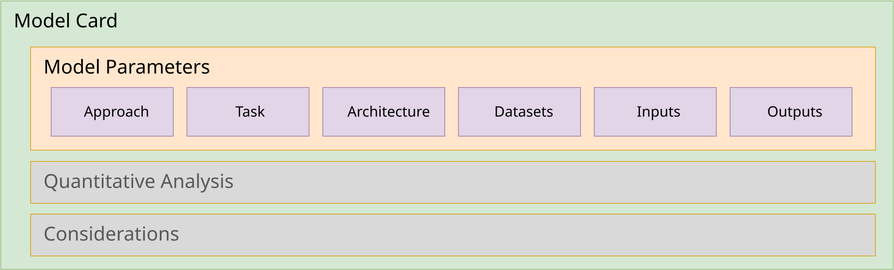

# Model properties



<!-- TODO(2.0): update ml-anatomy-model-card-parameters.svg to show component.modelProperties (learningTypes, tasks, architecture, parameterCount, quantization, inputs, outputs, training, limitations) -->

This section will feature guidance on filling out information in the CycloneDX model component's `modelProperties` object and its subcomponents, including:

* [Model metadata](#model-metadata)
  * [Learning types](#learning-types) - The learning paradigms used to train the model.
  * [Tasks](#tasks) - The tasks the model is designed to perform, which directly influence the input and/or output. Examples include classification, regression, text generation, etc.
  * [Architecture](#architecture) - The model's architecture, described by its family (e.g., Transformer, Convolutional Neural Network (CNN), Recurrent Neural Network (RNN)), its structural features, its runtime topology, and the name of its specific implementation (e.g., `LlamaForCausalLM`, ResNet-50, YOLOv3).
  * [Parameter count & quantization](#parameter-count--quantization)
  * [Providing links to papers & articles](#providing-links-to-papers--articles)
* [Datasets](#datasets) - The datasets used to train and evaluate the model.
  * [Declaring datasets](#declaring-datasets)
* [Inputs & Outputs](#inputs--outputs) - Describes the input and output parameters of the model.
* [Declaring other properties](#declaring-other-properties)
  * [Configuration parameters & hyperparameters](#configuration-parameters--hyperparameters)

> **CycloneDX 1.7 → 2.0**: The 1.7 `modelCard.modelParameters` object is replaced by `modelProperties` on the model `component`. The 1.7 `approach.type`, `task`, `architectureFamily`, and `modelArchitecture` strings are replaced by the `learningTypes`, `tasks`, and `architecture` fields, which use controlled vocabularies that can be validated and compared across BOMs.

## Model metadata

The `modelProperties` fields, grouped in this section, are intended to describe some of the metadata used to classify the associated ML model.

### Learning types

Describes the learning paradigms used to train the model. Since modern models often combine several paradigms (e.g., self-supervised pre-training followed by supervised fine-tuning and reinforcement-learning-based alignment), `learningTypes` is an array which supports the following predefined values:

| Type | Description |
|---|---|
| **supervised** | Supervised machine learning involves training an algorithm on labeled data to predict or classify new data based on the patterns learned from the labeled examples. |
| **unsupervised**	| Unsupervised machine learning involves training algorithms on unlabeled data to discover patterns, structures, or relationships without explicit guidance, allowing the model to identify inherent structures or clusters within the data. |
| **reinforcement-learning** | Reinforcement learning is a type of machine learning where an agent learns to make decisions by interacting with an environment to maximize cumulative rewards, through trial and error. |
| **semi-supervised** | Semi-supervised machine learning utilizes a combination of labeled and unlabeled data during training to improve model performance, leveraging the benefits of both supervised and unsupervised learning techniques. |
| **self-supervised** | Self-supervised machine learning involves training models to predict parts of the input data from other parts of the same data, without requiring external labels, enabling learning from large amounts of unlabeled data. |

A custom learning type may be provided as an object with a `name` and `description` when none of the predefined values apply.

Please note that links to external documentation detailing the model training approach (and other information) can be provided using [external references](#providing-links-to-papers--articles), which are discussed later in this section. Detailed training workflows (e.g., sequenced pre-training, fine-tuning, and alignment phases) can be described using CycloneDX `formulation` and referenced from `modelProperties.training.formula` (see [Including manufacturing information for the ML model](0x40-Design-Additional-Model-Information.md#including-manufacturing-information-for-the-ml-model)).

### Tasks

Describes the tasks (or goals) the machine learning model is designed to perform.  A model may support multiple tasks, so `tasks` is an array.  CycloneDX 2.0 predefines a vocabulary of tasks aligned with common model hub categories, including:

* **Text**: `text-generation`, `text-classification`, `token-classification`, `question-answering`, `summarization`, `translation`, `text-to-text`, `fill-mask`, `sentence-similarity`, `zero-shot-classification`, `few-shot-learning`
* **Vision & multimodal**: `image-classification`, `image-segmentation`, `object-detection`, `image-to-image`, `image-to-text`, `text-to-image`, `text-to-video`, `depth-estimation`, `video-classification`
* **Audio**: `audio-classification`, `automatic-speech-recognition`, `audio-to-audio`, `text-to-audio`, `text-to-speech`, `voice-activity-detection`
* **Tabular, time-series & other**: `tabular-classification`, `tabular-regression`, `time-series-forecasting`, `reinforcement-learning`, `robotics`, `graph-ml`, `feature-extraction`, `embedding`

Tasks not covered by the predefined values (for example, the more general categories below) may be declared as custom tasks using an object with a `name` and `description`:

* **Anomaly Detection**: Identifying outliers or unusual patterns in data.
* **Clustering**: Grouping unlabeled data based on similar characteristics (e.g., customer segmentation).
* **Dimensionality Reduction**: Simplifying complex data by reducing the number of variables while preserving core information.
* **Recommendation/Association**: Finding relationships between items (e.g., "users who bought this also bought...").

### Architecture

The `architecture` object describes what a model is built from, how it is built, and how it runs, using three tiers of controlled vocabulary, along with a `name` and `description` for the specific implementation:

| Field | Question answered | Cardinality |
|---|---|---|
| `family` | What is the model fundamentally built from? | one value |
| `features` | Which structural mechanisms does it use? | array |
| `topology` | How are parameters activated at runtime? | one value |

Each tier accepts a predefined value or a custom object with a `name` and `description`, so every tier remains extensible.

#### Architecture family

An architecture family defines the model's neural network's structural and data-processing methodology.  It typically does not describe a single model but rather the general design of the neural network (NN), the mathematical approach, context, attention mechanisms, and the like.  It should provide insight to those versed in the field on how the model is constructed.

The predefined architecture family values are: `transformer`, `cnn`, `rnn`, `lstm`, `gru`, `gan`, `vae`, `mamba`, `ssm`, `gnn`, `mlp`, `rwkv`, `snn`, `kan`, `diffusion`, `flow-matching`, `rbm`, `capsnet`, `neuromorphic`, and `hybrid` (for models that combine families, such as hybrid Mamba/Transformer designs).

Some examples of commonly referenced neural network (NN) architecture families include:

* **Transformers** (`transformer`) - an architecture designed to process sequential data (like text, speech, or images) in parallel rather than in order.
* **Convolutional Neural Network** (`cnn`) - an architecture designed to efficiently detect patterns (like edges, shapes, and textures) to typically classify or analyze visual (videos/image) or auditory data, but can be applied to text analysis, behavioral patterns and more.
* **Recurrent Neural Network** (`rnn`) - an architecture designed for processing sequential data like text, speech, and time series, typically used for tasks where order matters, such as language translation, speech recognition and time-series forecasting.
* **Long Short-Term Memory** (`lstm`) -  a specialized variant of a Recurrent Neural Network (RNN) architecture designed specifically to overcome the limitations of traditional RNNs in learning long-term dependencies.
* **Gated Recurrent Units** (`gru`) - a specialized variant of a Recurrent Neural Network (RNN) architecture designed to overcome challenges like the vanishing gradient problem and enhance the modeling of long-term dependencies in sequential datasets.
* **Generative Adversarial Networks** (`gan`) - an architecture used to train two neural networks, a *Generator* and a *Discriminator*, to compete against each other to generate more authentic data from a starting training dataset. The Generator tries to fool the Discriminator by creating fake data, while the Discriminator tries to identify fakes, leading to continuous improvement in data quality.

Again, the list above represents architecture families commonly referenced in research to establish an understanding of general model design; however, the architectural landscape continues to grow as researchers specialize and optimize for different use cases, goals, and datasets.

#### Architecture features

Architecture features identify the structural mechanisms present in a model, including macro-level layouts, attention variants, and parameter-efficient adaptation mechanisms.  The predefined values are:

* **Layout**: `decoder-only`, `encoder-only`, `encoder-decoder`, `dual-encoders`, `siamese-network`, `u-net`, `vae-bottleneck`, `hybrid-backbone`, `state-space-model`, `flow-matching`, `mixture-of-experts`
* **Attention & positional encoding**: `cross-attention`, `cross-attention-gated`, `grouped-query-attention`, `sliding-window-attention`, `rotary-position-embedding`
* **Layers & adaptation**: `residual-connections`, `gated-linear-units`, `adapter-layers`, `projector-layers`, `vision-encoder`, `multimodal-fusion`
* **Inference & augmentation**: `speculative-decoding`, `retrieval-augmented`, `memory-augmented`, `reranker`

#### Architecture topology

The topology describes how the model's parameters are activated at runtime.  The predefined values are: `dense`, `sparse` (e.g., Mixture-of-Experts routing), `dynamic`, `liquid`, `mixture-of-depths`, `early-exit`, and `recurrent-hybrid`.

#### Architecture name

The architecture `name` field is intended to include specific keywords to identify an implementation (class or library) or technical descriptors of the architectural "blueprint" needed to run a specific model.

These are typically found in one of several locations relative to the model:

* **Model Card**: the associated "model card" (e.g., `README.md` in Hugging Face) may contain mentions of specific class names like `LlamaForCausalLM`, `BertModel`, or `VisionTransformer`.
* **Framework-Specific Implementation Keywords** or tags: Depending on your code environment (PyTorch, TensorFlow, llama.cpp, etc.) that identify specific model code within the platform or environment.
* **Framework-Specific Configuration files** (e.g., Hugging Face transformer's `config.json` file): may contain the name of the class or function used to configure the framework for the specific implementation recommended for the associated model.
* **Academic Research Papers** (e.g., arXiv): may include detailed descriptors of processing algorithms, supported training or inference engines or specific, named implementations

### Parameter count & quantization

* **parameterCount** - The total number of trainable parameters of the model, expressed as an integer (e.g., `7000000000` rather than `"7B"`).
* **quantization** - Describes the quantization applied to the model's weights (if any), including the `method` (e.g., `k-quant`, `gptq`, `awq`), the number of `bits`, the `scheme` (`affine` or `symmetric`), the `granularity` (`per-tensor`, `per-channel`, or `per-group`), and for grouped or per-channel quantization, the `groupSize` and `axis`.

###### Example: Model metadata for the Qwen-7B model

This example demonstrates best practices for the Qwen-7B model using information published within and for the model's repository on Hugging Face.

```json
{
  "$schema": "https://cyclonedx.org/schema/2.0/cyclonedx-2.0.schema.json",
  // ...,
  "inventories": [
    {
      "subject": {
        "type": "machine-learning-model",
        "refId": "pkg:huggingface/Qwen/Qwen-7B@ef3c5c9",
        "name": "Qwen/Qwen-7B",
        // ...,
        "modelProperties": {
          "learningTypes": [ "self-supervised", "supervised", "reinforcement-learning" ],
          "tasks": [ "text-generation" ],
          "architecture": {
            "name": "QWenLMHeadModel",
            "description": "Decoder-only Transformer using rotary position embeddings and SwiGLU activations.",
            "family": "transformer",
            "features": [
              "decoder-only",
              "rotary-position-embedding",
              "gated-linear-units"
            ],
            "topology": "dense"
          },
          "parameterCount": 7000000000
          // ...
        }
      },
      "components": [
        // ...
      ]
    }
  ]
}
```

###### Field discussion

* **learningTypes** - Qwen-7B was pre-trained using self-supervised (next-token prediction) learning on a large corpus; the supervised fine-tuning (SFT) and reinforcement learning from human feedback (RLHF) methods, also declared as [hyperparameter properties](#example-model-parameters--hyperparameters-for-the-qwen-7b-model) later in this section, are represented by `supervised` and `reinforcement-learning`.
* **architecture.name** - the value `QWenLMHeadModel` was located in the model's `config.json` model configuration file.
* **architecture.features** - Lists the structural mechanisms documented in the Qwen Technical Report.
* **architecture.topology** - The value `dense` indicates that all of the model's parameters are active for each token (in contrast to a `sparse` Mixture-of-Experts model).
* **parameterCount** - The nominal parameter count ("7B") as published by the model provider, expressed as an integer.

#### Providing links to papers & articles

Most models are fully described in terms of research papers, articles, and other reference documents.  In those cases, they should be provided as `externalReferences` under the `component`.  Links specific to the architecture may also be provided as `externalReferences` within the `architecture` object itself.

###### Example: "Qwen Technical Report"

This shows how the Qwen research team disclosed comprehensive details about the Qwen model's design, training, implementation, and evaluation as a formal research paper in Cornell University's arXiv scholarly article distribution service.

```json
{
  "$schema": "https://cyclonedx.org/schema/2.0/cyclonedx-2.0.schema.json",
  // ...,
  "inventories": [
    {
      "subject": {
        "type": "machine-learning-model",
        "refId": "pkg:huggingface/Qwen/Qwen-7B@ef3c5c9",
        "name": "Qwen/Qwen-7B",
        // ...,
        "externalReferences": [
          {
            "type": "documentation",
            "url": "https://arxiv.org/abs/2309.16609",
            "comment": "Qwen Technical Report"
          }
        ]
      },
      "components": [
        // ...
      ]
    }
  ]
}
```

## Datasets

Details the datasets used to train and evaluate the model.

#### Declaring datasets

In CycloneDX 2.0, each dataset used to train, fine-tune, test, or evaluate a machine learning model is described as a CycloneDX component of type `data` and referenced from the model:

* **Training datasets** are referenced from `modelProperties.training.datasets`, using the `refId` of the data component (or a BOM-Link to a data component declared in another BOM).
* **Evaluation datasets** are referenced from each performance metric's `evaluationDatasets` (see [Quantitative analysis](0x23-Design-Model-Card-Quantitative-Analysis.md#model-quantitative-analysis)).

> **CycloneDX 1.7 → 2.0**: The 1.7 `modelParameters.datasets` array allowed either in-line dataset objects or `ref` references to data components.  In 2.0, `modelProperties.training.datasets` contains only references; information previously provided in-line is now provided on the referenced `data` component (e.g., within its `data` array).

How much detail is provided for each data component depends on the context, as discussed in the next sections.

##### Datasets with minimal information

A data component may be kept minimal to simplify the association between training datasets and the model, specifically addressing scenarios where data is difficult to reference as an independent, fully described component.

Key applications:

* **Filtered Data**: Documenting specific slices or individual snippets of data used for fine-tuning or testing.
* **Private Repositories**: Providing transparency via BOMs for non-public datasets in public model cards (e.g, private data used for models in the healthcare or financial services industries).
* **Unstructured Sources**: Referencing data not housed in traditional databases or management tools (e.g., data within S3 buckets, event data within Security information and event management (SIEM) systems).

<div style="page-break-after: always; visibility: hidden">
\newpage
</div>

###### Example: Custom health model with private dataset

This example shows a model fine-tuned (by a fictional "ACME Health" company) from the public [m42-health/Llama3-Med42-8B](https://huggingface.co/m42-health/Llama3-Med42-8B) model using a private dataset.

```json
{
  "$schema": "https://cyclonedx.org/schema/2.0/cyclonedx-2.0.schema.json",
  "specFormat": "CycloneDX",
  "specVersion": "2.0",
  "serialNumber": "urn:uuid:3e671687-395b-41f5-a30f-a58921a69b79",
  "version": 1,
  "inventories": [
    {
      "subject": {
        "type": "machine-learning-model",
        "refId": "pkg:huggingface/acme-health/custom-Llama3-Med42-8B@2ee9dc9",
        "name": "acme-health/custom-Llama3-Med42-8B",
        "description": "Customized Med42-v2 large language models (LLMs) which uses the Llama3 architecture and fine-tuned using private clinical dataset.",
        // ...,
        "modelProperties": {
          // ...,
          "training": {
            "datasets": [
              "dataset-ultrafeedback",
              // ...,
              "dataset-acme-midwest-health"
            ]
          }
          // ...
        }
      },
      "components": [
        {
          "type": "data",
          "refId": "dataset-ultrafeedback",
          "name": "UltraFeedback dataset",
          "data": [
            {
              "type": "dataset",
              "classification": "public",
              "contents": {
                "url": "https://huggingface.co/datasets/openbmb/UltraFeedback"
              }
            }
          ]
        },
        // ...,
        {
          "type": "data",
          "refId": "dataset-acme-midwest-health",
          "name": "ACME Midwest health data",
          "data": [
            {
              "type": "dataset",
              "classification": "confidential",
              "contents": {
                "url": "https://acme.ai/adatasets/health/patient?region=midwest"
              }
            }
          ]
        }
      ]
    }
  ]
}
```

###### Field discussion

* **classification** - The predefined data classifications are `public`, `internal`, `confidential`, `restricted`, and `classified` (custom classifications are also supported).  The ACME private dataset is classified as `confidential`.
* **url** - Please note that URLs may be to either public or private resources.  For example, in the case of the ACME `confidential` dataset above, the URL is likely behind an Access Control Point (ACP) which regulates traffic to the private resource in accordance with the ACME company's governance policies.

##### Datasets as fully described data components

This method is preferable for most security and compliance contexts, as it allows for the full expression of provenance, pedigree, attestations, and other contextual information as a full CycloneDX component.

###### Example: health model with public datasets

This example shows the recommended best practice of declaring the datasets for the base model used in the previous example (i.e., [m42-health/Llama3-Med42-8B](https://huggingface.co/m42-health/Llama3-Med42-8B)) as their own, fully identified CycloneDX components.

The public datasets, as documented in the model's research paper, include:

* [openbmb/UltraFeedback](https://huggingface.co/datasets/openbmb/UltraFeedback)
* [snorkelai/Snorkel-Mistral-PairRM-DPO](https://huggingface.co/snorkelai/Snorkel-Mistral-PairRM-DPO)

```json
{
  "$schema": "https://cyclonedx.org/schema/2.0/cyclonedx-2.0.schema.json",
  "specFormat": "CycloneDX",
  "specVersion": "2.0",
  "serialNumber": "urn:uuid:eb033070-85d1-45f4-9eb7-f50510f83853",
  "version": 1,
  "inventories": [
    {
      "subject": {
        "type": "machine-learning-model",
        "refId": "pkg:huggingface/m42-health/Llama3-Med42-8B@ceab7e7",
        "name": "m42-health/Llama3-Med42-8B",
        "description": "an open, clinical large language models (LLM) instruct and preference-tuned by M42 to expand access to medical knowledge. Built off LLaMA-3 and designed to provide high-quality answers to medical questions.",
        "identifiers": [
          {
            "party": "party-hugging-face",
            "identities": [
              { "scheme": "purl", "value": "pkg:huggingface/m42-health/Llama3-Med42-8B@ceab7e7ee4b9dbde7ba82867f34274db51487d83" }
            ]
          }
        ],
        // ...,
        "modelProperties": {
          // ...,
          "training": {
            "datasets": [
              "pkg:huggingface/openbmb/UltraFeedback@40b4365",
              "pkg:huggingface/snorkelai/Snorkel-Mistral-PairRM-DPO@07af5d0a"
            ]
          }
        }
      },
      "components": [
        {
          "name": "UltraFeedback dataset",
          "type": "data",
          "refId": "pkg:huggingface/openbmb/UltraFeedback@40b4365",
          "identifiers": [
            {
              "party": "party-hugging-face",
              "identities": [
                { "scheme": "purl", "value": "pkg:huggingface/openbmb/UltraFeedback@40b436560ca83a8dba36114c22ab3c66e43f6d5e" }
              ]
            }
          ]
          // ...
        },
        {
          "name": "Snorkel-Mistral-PairRM-DPO dataset",
          "type": "data",
          "refId": "pkg:huggingface/snorkelai/Snorkel-Mistral-PairRM-DPO@07af5d0a",
          "identifiers": [
            {
              "party": "party-hugging-face",
              "identities": [
                { "scheme": "purl", "value": "pkg:huggingface/snorkelai/Snorkel-Mistral-PairRM-DPO@07af5d0a875b4c692dfaff6c675b10af07b45511" }
              ]
            }
          ]
          // ...
        }
      ]
    }
  ],
  "definitions": {
    "parties": [
      {
        "refId": "party-hugging-face",
        "roles": [ { "role": "supplier" } ],
        "organization": { "name": "Hugging Face" }
      }
    ]
  }
}
```

> **Tip**: Datasets may be further described using properties from the proposed `cdx:ai-ml:dataset` namespace of the [CycloneDX Property Taxonomy](https://github.com/CycloneDX/cyclonedx-property-taxonomy) ([PR #175](https://github.com/CycloneDX/cyclonedx-property-taxonomy/pull/175)), such as the dataset's `stage`, `category`, and EU AI Act data `sources`.

<!-- TODO(2.0): update the dataset property names/examples once taxonomy PR #175 is merged -->
<div style="page-break-after: always; visibility: hidden">
\newpage
</div>

### Inputs & outputs

Describes the input and output parameters of the model.  Each entry in the `inputs` and `outputs` arrays describes one parameter, including its:

* **name** and **description**
* **modality** - `text`, `image`, `audio`, `video`, `multimodal`, `embedding`, or `logits`
* **dataType** - The numeric or symbolic data type (e.g., `string`, `float32`, `bfloat16`, `int64`, `uint8`)
* **mimeType** - The media type for encoded content (e.g., `image/png`)
* **shape** - The dimensional shape (e.g., tensor dimensions), where dynamic dimensions are expressed as `null` or `-1`
* **processingStage** - The stage of the parameter relative to tokenization or encoding: `pre-tokenizer`, `post-tokenizer`, `pre-encoder`, `post-encoder`, `pre-processing`, `post-processing`, or `raw`
* **required**, **defaultValue**, and **constraints** (e.g., `minLength`, `maxLength`, `minValue`, `maxValue`, `allowedValues`, `pattern`)

> **CycloneDX 1.7 → 2.0**: The 1.7 `inputs`/`outputs` objects only supported a single `format` string.

```json
{
  "$schema": "https://cyclonedx.org/schema/2.0/cyclonedx-2.0.schema.json",
  // ...,
  "inventories": [
    {
      "subject": {
        "type": "machine-learning-model",
        "refId": "pkg:huggingface/Qwen/Qwen-7B@ef3c5c9",
        "name": "Qwen/Qwen-7B",
        // ...,
        "modelProperties": {
          // ...,
          "inputs": [
            {
              "name": "prompt",
              "description": "The text prompt to be completed by the model.",
              "modality": "text",
              "dataType": "string",
              "processingStage": "pre-tokenizer",
              "required": true
            }
          ],
          "outputs": [
            {
              "name": "completion",
              "description": "The generated text completion.",
              "modality": "text",
              "dataType": "string",
              "processingStage": "post-processing"
            }
          ]
        }
      },
      "components": [
        // ...
      ]
    }
  ]
}
```

In order to provide information on other model configuration parameters and hyperparameters, it is recommended to follow the best practice as shown in the next section "[Declaring other properties](#declaring-other-properties)" and its "[Example: Model parameters & hyperparameters for the Qwen-7B model](#example-model-parameters--hyperparameters-for-the-qwen-7b-model)".

<div style="page-break-after: always; visibility: hidden">
\newpage
</div>

### Declaring other properties

#### Configuration parameters & hyperparameters

In general, model configuration parameters describe values used to configure model processing applications, frameworks, and implementations of model architectures.  For example, most models on Hugging Face typically include configuration files for both the models and the tokenizers they are designed to work with, using the [Hugging Face Transformers](https://huggingface.co/docs/transformers/) library and its underlying PyTorch framework.

> **Note**: Configuration parameters and hyperparameters that are not represented by native `modelProperties` fields are provided using CycloneDX `properties` and the [CycloneDX Property Taxonomy](https://github.com/CycloneDX/cyclonedx-property-taxonomy) reserved namespaces `cdx:ai-ml:model:parameter` and `cdx:ai-ml:model:hyperparameter` as needed.  Because the taxonomy can be extended at any time (independently of the schema's standardization cycle), it is the preferred mechanism for describing the rapidly evolving set of AI/ML configuration values.

###### Example: Model parameters & hyperparameters for the Qwen-7B model

As shown in the [Qwen/Qwen-7B model repository files](0x20-Design-Model-Component-Metadata.md#example-qwenqwen-7b-model-repository-files) example in the previous section, we see the model includes several configuration files, including:

- [config.json](https://huggingface.co/Qwen/Qwen-7B/blob/main/config.json) - which contains configuration parameters (as key-value pairs) used for initializing the model's implementation.
- [generation_config.json](https://huggingface.co/Qwen/Qwen-7B/blob/main/generation_config.json) - which contains model hyperparameters (as key-value pairs) and their suggested (default) values used for configuring the model for token generation (inference).

The JSON below shows how a few of the [Qwen/Qwen-7B](https://huggingface.co/Qwen/Qwen-7B) model's parameters, as contained in the [config.json](https://huggingface.co/Qwen/Qwen-7B/blob/main/config.json) configuration file, would be declared within the CycloneDX `modelProperties` object's `properties` array using the CycloneDX reserved namespace for AI/ML.

```json
{
  "$schema": "https://cyclonedx.org/schema/2.0/cyclonedx-2.0.schema.json",
  // ...,
  "inventories": [
    {
      "subject": {
        "type": "machine-learning-model",
        "refId": "pkg:huggingface/Qwen/Qwen-7B@ef3c5c9",
        "name": "Qwen/Qwen-7B",
        // ...,
        "modelProperties": {
          // ...,
          "parameterCount": 7000000000,
          "properties": [
            {
              "name": "cdx:ai-ml:model:parameter:tune_method",
              "value": "sft"
            },
            {
              "name": "cdx:ai-ml:model:parameter:tune_method",
              "value": "rlhf"
            },
            {
              "name": "cdx:ai-ml:model:hyperparameter:num_hidden_layers",
              "value": "32"
            },
            {
              "name": "cdx:ai-ml:model:hyperparameter:hidden_size",
              "value": "4096"
            },
            {
              "name": "cdx:ai-ml:model:hyperparameter:context_length",
              "value": "8192"
            },
            {
              "name": "cdx:ai-ml:model:hyperparameter:vocab_size",
              "value": "151936"
            },
            {
              "name": "cdx:ai-ml:model:hyperparameter:quantization",
              "value": "BF16"
            }
            // ...
          ]
        }
      },
      "components": [
        // ...
      ]
    }
  ]
}
```

###### Field discussion

Please note that the example above includes only a small set of parameters and hyperparameters that extend the `cdx:ai-ml:model:parameter` and `cdx:ai-ml:model:hyperparameter` paths. Actual models may have a more comprehensive set of properties declared.

The example above contains the following native field and `cdx:ai-ml:model:parameter` and `cdx:ai-ml:model:hyperparameter` properties, which are explained below:

- **parameterCount** - Total number of learned parameters in the model.  In CycloneDX 2.0, this native integer field replaces the `cdx:ai-ml:model:parameter:count` property.
- **properties**

  * **context_length** - The maximum sequence length the model supports during training and inference.
  * **num_hidden_layers** - The total number of intermediate (hidden) processing layers situated between the input layer and the output layer of the model.
  * **hidden_size** - The dimension of the input and output representations (i.e., of the token embeddings) used by the internal (hidden) layers of a model's neural network.
  * **tune_method** - Indicates the fine-tuning methods used to develop the model. In this case, `sft` (Supervised Fine-Tuning) and `rlhf` (Reinforcement Learning from Human Feedback).
  * **quantization** - The numerical precision (number of bits) used to store the model's tensor weights, which affects model memory usage.  Where a model's weights have been quantized (e.g., 4-bit GGUF `Q4_K_M`), the quantization method, bits, scheme, and granularity should also be described using the native `modelProperties.quantization` object.
  * **vocab_size** - The size of the model's vocabulary.

##### Tokenizer parameters and hyperparameters

The same methodology used to provide model hyperparameter names and values for models can also be applied to model tokenizers by instead using the `cdx:ai-ml:tokenizer:hyperparameter` path and extending it with a path with a parameter name.

<div style="page-break-after: always; visibility: hidden">
\newpage
</div>
