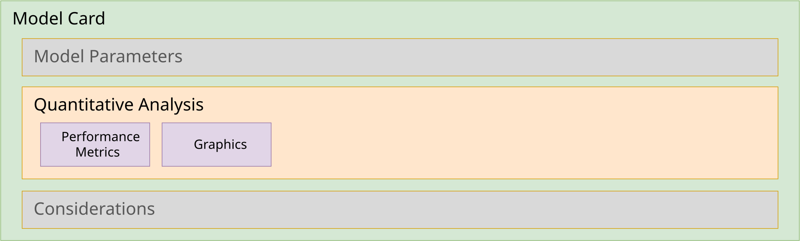
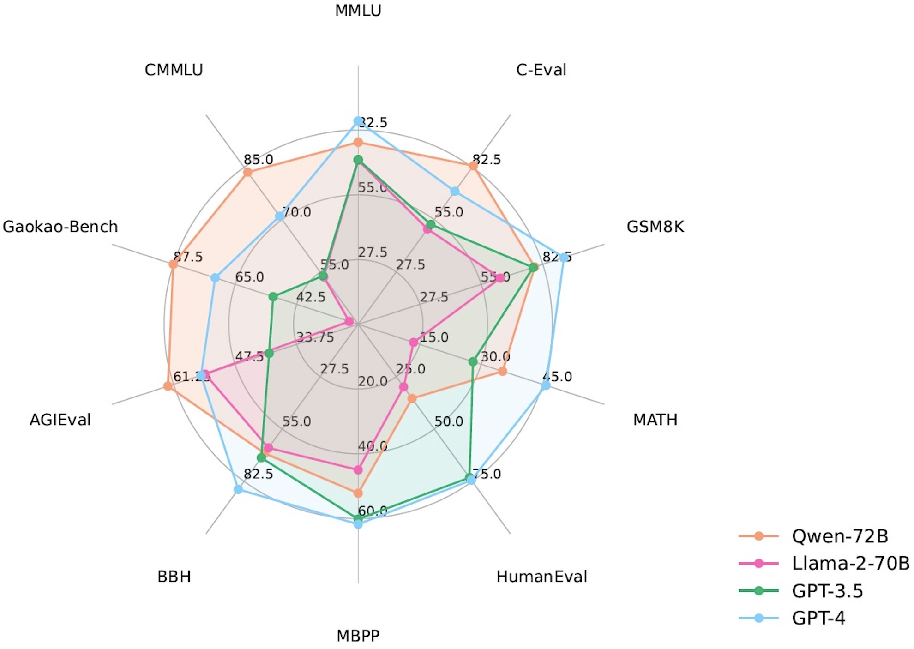

# Model quantitative analysis



<!-- TODO(2.0): update ml-anatomy-model-card-quant-analysis.svg to show component.measurements (performanceMetric) and definitions.graphics -->

This section will feature guidance on providing quantitative analysis information using the CycloneDX model component's `measurements` array and its performance metric objects, including:

* [Metrics](#metrics)
  * [Performance metrics](#performance-metrics)
* [Graphics](#graphics)

> **CycloneDX 1.7 → 2.0**: The 1.7 `modelCard.quantitativeAnalysis.performanceMetrics` array is replaced by performance metric entries in the component's `measurements` array.  Each metric now has a separate `type` and `benchmark`, a typed `measure` with a numeric `value` and a `unit`, numeric `confidenceInterval` bounds, and references to the `evaluationDatasets` used.  The 1.7 `quantitativeAnalysis.graphics` collection is replaced by per-metric `graphics`.

## What is quantitative analysis

Quantitative analysis is the process of using metrics on benchmarks to determine if a model is reliable, safe, or better than another. It involves comparing the metric results against the benchmark standard to assess performance, identify limitations, and track progress over time.

<!-- A quantitative analysis of an AI model involves using mathematical and statistical methods to objectively measure and evaluate its performance, behavior, and outputs using numerical data, focusing on how much or how often, unlike qualitative analysis, which looks at why. It assesses metrics such as accuracy, precision, recall, efficiency, and consistency, transforming raw data into verifiable insights to understand patterns, test hypotheses, and ensure reliable decision-making, moving beyond subjective human interpretation. -->

### The value of quantitative analysis

* **Numerical Metrics**: Provides measurable data (e.g., error rates, latency, performance scores) rather than subjective feedback.
* **Objective Evaluation**: Provides reproducible, scalable results that can be compared across different models or versions.
* **Pattern & Trend Detection**: Identifies numerical patterns, correlations, and trends within large or complex datasets that might be missed manually.
* **Testing Hypotheses**: Enables the statistical testing of assumptions about model behavior allowing for comparisons against similar models for given tasks.

## Benchmarks

Benchmarks are standardized test datasets, scenarios, or tasks that define the "playing field". They provide a consistent environment for evaluating different models and enable the comparison of their metrics across similar models.

### Types of machine learning benchmarks

Benchmarks use standardized datasets to objectively compare model quality, efficiency, fairness, and speed, providing a shared baseline for identifying areas for improvement in various categories.

* [Large Language Models (LLM)](0x90-Appendix-A_Glossary.md#large-language-model-llm) and [Natural Language Processing (NLP)](0x90-Appendix-A_Glossary.md#natural-language-processing-nlp) (e.g., speech recognition or text classification): These benchmarks evaluate reasoning, knowledge, and generation capabilities. A few examples of datasets used to benchmark these models against different tasks include:

  * **General Tasks**
    * [MMLU](https://huggingface.co/datasets/cais/mmlu), [MMLU-Pro](https://huggingface.co/datasets/TIGER-Lab/MMLU-Pro) (Massive Multitask Language Understanding): Tests knowledge across STEM, humanities, and social sciences.
    * [HellaSwag](https://huggingface.co/datasets/Rowan/hellaswag) / [WinoGrande](https://huggingface.co/datasets/allenai/winogrande): Common sense reasoning and pronoun resolution tasks.
    * [GLUE](https://gluebenchmark.com/): benchmarking resources for training, evaluating, and analyzing natural language understanding systems. GLUE's dataset is available in Hugging Face Hub ([nyu-mll/glue](https://huggingface.co/datasets/nyu-mll/glue)) and supports multiple tasks that can be evaluated independently, for example:
      * *ax* - evaluates sentence understanding through Natural Language Inference (NLI) problems.
      * *cola* - The Corpus of Linguistic Acceptability consists of English acceptability judgments drawn from books and journal articles on linguistic theory.
      * *mnli* - The Multi-Genre Natural Language Inference Corpus consists of sentence pairs with textual entailment annotations. Given a premise sentence and a hypothesis sentence, the task is to predict whether the premise entails the hypothesis.
  * **Math/STEM tasks**
    * [GSM8K](https://huggingface.co/datasets/openai/gsm8k) (OpenAI, Grade School Math 8K): a dataset of 8.5K high quality linguistically diverse grade school math word problems.
    * [MATH-500](https://huggingface.co/datasets/HuggingFaceH4/MATH-500) (Hugging Face): Benchmarks specifically designed to evaluate mathematical reasoning.
  * **Coding Tasks**
    * [HumanEval](https://huggingface.co/datasets/openai/openai_humaneval) (OpenAI): used to evaluate the functional correctness of code generated LLMs. It consists of hand-crafted programming problems designed to test reasoning and code synthesis abilities.
    * [MBPP](https://huggingface.co/datasets/Muennighoff/mbpp) (Mostly Basic Python Problems ): Benchmarks for evaluating code generation and programming capabilities.
    * [CodeXGLUE](https://github.com/microsoft/CodeXGLUE/tree/main/Code-Code/code-refinement) (MicroSoft, Code Refinement): Used to evaluate a model's ability to remove (i.e., "fix") bugs from Java code (i.e., refine the code) with accuracy being reported as [BLEU](https://learn.microsoft.com/en-us/azure/ai-services/translator/custom-translator/concepts/bleu-score) scores.
  * **Other Tasks**
    * [IMDB](https://www.kaggle.com/datasets/lakshmi25npathi/imdb-dataset-of-50k-movie-reviews): a large dataset of 50K, highly polarized, movie reviews for NLP sentiment analysis and classification.

* [Computer Vision](0x90-Appendix-A_Glossary.md#computer-vision) (e.g., digital image or video recognition): These benchmarks measure the performance, accuracy, and efficiency of models in tasks like image classification, object detection, segmentation, and tracking. Some example "vision" datasets include:
  
  * [ImageNet](https://image-net.org): large-scale dataset for computer vision, featuring over 14 million annotated, high-resolution images across thousands of object categories organized by the [WordNet](https://en.wikipedia.org/wiki/WordNet) hierarchy.
  * [MathVista](https://huggingface.co/datasets/AI4Math/MathVista): Used to evaluating math reasoning in Visual Contexts.  It consists of three datasets, *IQTest*, *FunctionQA*, and *PaperQA*, which are tailored to evaluate visual reasoning on puzzle test figures, algebraic reasoning over functional plots, and scientific reasoning with academic paper figures, respectively.
  * [MNIST](https://www.tensorflow.org/datasets/catalog/mnist) (Modified National Institute of Standards and Technology database): a large database of handwritten digits (glyphs) that is commonly used for training various image processing systems.

Again, the list above contains only a small number of benchmarking datasets that can be used to train and evaluate models.

> **Tip**: Since a benchmark's dataset can be declared as a `data` component, each performance metric can reference the exact dataset (and version) it was computed against using `evaluationDatasets`.

## Metrics

AI benchmarking metrics are standardized, quantitative measures used to evaluate and compare the performance, accuracy, efficiency, and reliability of artificial intelligence models against established, uniform tasks and datasets. They serve as a gauge of progress in capabilities such as reasoning, coding, and language understanding, enabling simple comparisons with similar models.

> **Note**: A component's `measurements` array can contain both *performance metrics* (described in this section) and *energy consumption* measurements (see [Environmental considerations](0x24-Design-Model-Card-Considerations.md#environmental-considerations)).

#### Performance metrics

Performance metrics are specific, quantitative measures used to evaluate a model's behavior, such as accuracy, precision, recall, perplexity, or inference speed. They provide the raw, numerical data for analysis.

Each performance metric includes the following fields:

* **type** (required) - The type of metric (e.g., `accuracy`, `f1`, `pass@1`, `perplexity`, `latency`, `throughput`).
* **measure** (required) - The metric's numeric `value` and its `unit` (e.g., `%`, `1` for unitless ratios, `ms`, `tokens/s`).
* **benchmark** - The benchmark (and its configuration, e.g., number of shots) used to compute the metric.
* **slice** - The named subset of the evaluation data the metric was computed on.
* **confidenceInterval** - The numeric `lowerBound` and/or `upperBound` of the metric.
* **evaluationDatasets** - References to the `data` components the metric was computed against.
* **graphics** - Graphics (or references to graphics) illustrating the metric.

##### Common Performance Metrics

* **Accuracy**: Overall correctness; typically represented as a percentage of correct responses to the full set of problems posed by a benchmark's dataset.
* **Precision**: Of predicted positives, how many are correct.
* **Recall** (Sensitivity): Of actual positives, how many are found.
* **F1 Score**: Harmonic mean of *Precision* and *Recall*.
* **Latency/Throughput**: Speed of prediction (inference), e.g., time-to-first-token (`ms`) or generation rate (`tokens/s`).
<!-- * **ROC AUC** - Area under the Receiver Operating Characteristic curve. -->
<!-- * **Resource Utilization: Memory, CPU/GPU usage. -->

###### Example: Declaring the MMLU accuracy score for Qwen-7B

The Qwen accuracy scores for various benchmarks are published in the [QwenLM/Qwen](https://github.com/QwenLM/Qwen?tab=readme-ov-file#performance) GitHub repository's README.

This appears as a table that includes all Qwen models, along with other similar models for comparison.  Here is the table row for all Qwen-7B benchmarks:

| Model             |   MMLU   |  C-Eval  |  GSM8K   |   MATH   | HumanEval |   MBPP   |   BBH    |  CMMLU   |
|:------------------|:--------:|:--------:|:--------:|:--------:|:---------:|:--------:|:--------:|:--------:|
| **Qwen-7B**       |   58.2   |   63.5   |   51.7   |   11.6   |   29.9    |   31.6   |   45.0   |   62.2   |

The MMLU score from the table would be declared as a performance metric as follows:

```json
{
  "type": "machine-learning-model",
  "refId": "pkg:huggingface/Qwen/Qwen-7B@ef3c5c9",
  "name": "Qwen/Qwen-7B",
  // ...,
  "measurements": [
    {
      "type": "accuracy",
      "benchmark": "MMLU (5-shot)",
      "measure": {
        "value": 58.2,
        "unit": "%"
      },
      "confidenceInterval": {
        "lowerBound": 57.48,
        "upperBound": 58.92
      },
      "evaluationDatasets": [
        "pkg:huggingface/cais/mmlu"
      ]
    }
  ]
}
```

###### Field discussion

* **type** / **benchmark** - The metric type (`accuracy`) is separated from the benchmark and its configuration (`MMLU (5-shot)`), which allows the same metric type to be compared across benchmarks.
* **measure** - The value is provided as a number with an explicit unit (`%`) rather than as a string.
* **slice** - the `slice` property was omitted indicating the full dataset was used for performance benchmarking.
* **confidenceInterval** - the values provided reflect the 95% Statistical Confidence Interval (±0.72) of the accuracy for the full MMLU test set (approx. 14,000 questions).
* **evaluationDatasets** - References the `refId` of a `data` component (declared elsewhere in the BOM) describing the MMLU dataset.

###### Example: Declaring a GLUE F1 Score

This example shows how to provide an [F1 score](https://en.wikipedia.org/wiki/F-score) (i.e., the harmonic mean of precision and recall measurements) for a model's performance on classification tasks within the [GLUE benchmark](https://zilliz.com/glossary/glue-benchmark).

```json
{
  "measurements": [
    {
      "type": "f1",
      "benchmark": "GLUE",
      "slice": "cola",
      "measure": {
        "value": 0.87,
        "unit": "1"
      }
    }
  ]
}
```

###### Field discussion

* **slice** - the `slice` property references a named subset `cola` (Corpus of Linguistic Acceptability) which is a subset of the GLUE tests; "cola" consists of single-sentence task to determine if a sentence is grammatically correct or not.
* **unit** - The unit `1` denotes a unitless (dimensionless) ratio between 0 and 1.

## Graphics

Model cards typically include graphs, charts, and other graphics that highlight the model's performance benchmarks, often relative to other models.  This section exemplifies the use of the CycloneDX `graphics` object to include these graphics in the AI/ML-BOM as part of its quantitative analysis information.

Graphics may be provided in-line on a performance metric, or declared once in the BOM's `definitions.graphics` and referenced (by `refId`) from each metric they illustrate.

###### Example: Qwen model comparative benchmarks

The [QwenLM/Qwen](https://github.com/QwenLM/Qwen) GitHub repository includes the following JPG format spider diagram showing benchmarking comparisons for their Qwen2 models, along with some peer models:



This could be encoded in a CycloneDX AI/ML-BOM as follows:

```json
{
  "$schema": "https://cyclonedx.org/schema/2.0/cyclonedx-2.0.schema.json",
  // ...,
  "inventories": [
    {
      "subject": {
        "type": "machine-learning-model",
        "name": "Qwen/Qwen2-72B",
        // ...,
        "measurements": [
          {
            "type": "accuracy",
            "benchmark": "MMLU (5-shot)",
            "measure": { "value": 84.2, "unit": "%" },
            "graphics": [
              { "ref": "graphic-qwen2-benchmarks" }
            ]
          }
          // ...
        ]
      },
      "components": [
        // ...
      ]
    }
  ],
  "definitions": {
    "graphics": [
      {
        "refId": "graphic-qwen2-benchmarks",
        "name": "Qwen2 Performance Benchmarks (spider diagram)",
        "description": "benchmark_score",
        "image": {
          "mediaType": "image/jpeg",
          "encoding": "base64",
          "content": "/9j/4AAQSkZJRgABAQAAAQABAAD/2wBDAA"
        }
      }
    ]
  }
}
```

###### Field discussion

* **definitions.graphics** - Declaring the graphic once allows every metric shown in the spider diagram to reference it.
* **mediaType** - The media type of the image (in 1.7, this field was named `contentType`).
* **encoding** - CycloneDX, currently, only supports a `base64` encoding type.

<div style="page-break-after: always; visibility: hidden">
\newpage
</div>
