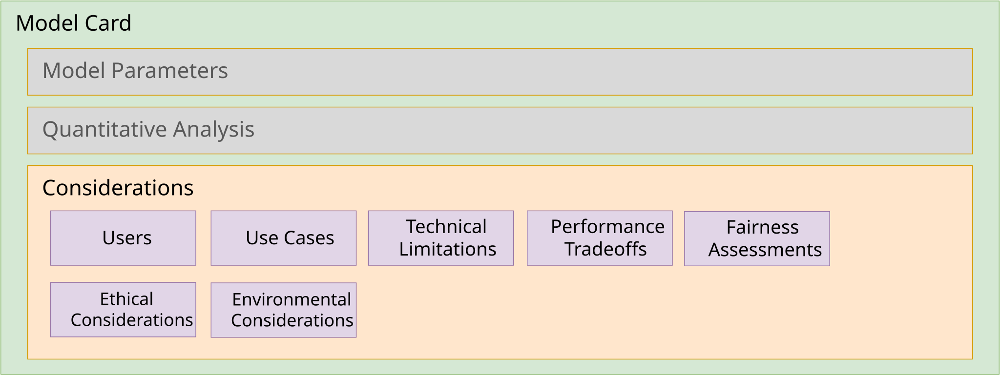

# Model Design Considerations



<!-- TODO(2.0): update ml-anatomy-model-card-considerations.svg to show parties, definitions.useCases, modelProperties.limitations, risks, and measurements (energy consumption) -->

This section will feature guidance on providing the design considerations for a model, including:

* [Users & use cases](#users--use-cases) - Who are the intended users of the model, and what are the intended use cases for the model inclusive of the Operational Design Domains (ODD)?
* [Technical limitations](#technical-limitations) - What are the known technical limitations of the model? For example, "What kind(s) of data should the model be expected not to perform well on?", "What are the factors that might degrade model performance?".
* [Performance tradeoffs](#performance-tradeoffs) - What are the known tradeoffs in accuracy/performance of the model?
* [Ethical considerations](#ethical-considerations) - How to disclose known ethical risks involved in the application of this model?
* [Fairness assessments](#fairness-assessments) - How does the model affect groups at risk of being systematically disadvantaged? What are the harms and benefits to the various affected groups?
* [Environmental considerations](#environmental-considerations) - What are the various environmental impacts the corresponding machine learning model has exhibited across its lifecycle?

> **CycloneDX 1.7 → 2.0**: The 1.7 `modelCard.considerations` object is replaced by several, more structured and referenceable objects:
>
> | CycloneDX 1.7 `considerations` field | CycloneDX 2.0 |
> |---|---|
> | `users` | `parties` (e.g., personas) with the `end-user` role |
> | `useCases` | `definitions.useCases`, whose `actors` reference parties, asserted by the model via `useCaseAssertions` |
> | `technicalLimitations` | `modelProperties.limitations` |
> | `performanceTradeoffs` | `modelProperties.limitations` (see [Performance tradeoffs](#performance-tradeoffs)) |
> | `ethicalConsiderations` | `risks.risks` with an `ethical` (or other) domain, whose `affects` references the model, and `responses` for mitigations |
> | `fairnessAssessments` | `risks.risks` with a `fairness` domain, whose `affects` references the model and the party (persona) at risk, with graded harm and benefit `impacts` |
> | `environmentalConsiderations` | Energy consumption entries in the model component's `measurements` |

## Users & use cases

The intended users of the model are described as CycloneDX `parties`, and its envisioned use cases are described as CycloneDX use cases.

* **Users** - Each kind of user is a party (typically a `persona`) with the `end-user` role.  Unlike a simple list of labels, a party may also be an identifiable `organization`, `person`, or `system` (e.g., an AI agent), with legal names, jurisdictions, and identifiers, so that obligations (e.g., as a deployer under the EU AI Act) can be assigned.
* **Use cases** - Each use case is declared in the BOM's `definitions.useCases`, naming its `actors` (references to parties) and optionally its pre- and post-conditions, main flow steps, alternative flows, exceptions, and success criteria.
* **Use case assertions** - The model component declares its relationship to each use case using `useCaseAssertions` (e.g., `implements`, `supports`, `participates-in`, or `inhibits`).

###### Example: Qwen/Qwen-7B

This example shows what kind of user and use case information would be expected for a typical `7B` parameter size Large Language Model (LLM) that is multi-lingual and supports code/instruct capabilities.

```json
{
  "$schema": "https://cyclonedx.org/schema/2.0/cyclonedx-2.0.schema.json",
  // ...,
  "inventories": [
    {
      "subject": {
        "type": "machine-learning-model",
        "refId": "pkg:huggingface/Qwen/Qwen-7B@ef3c5c9",
        "name": "Qwen/Qwen-7B",
        // ...,
        "useCaseAssertions": [
          {
            "assertionType": "supports",
            "useCaseRefs": [
              "uc-code-assistant",
              "uc-translation",
              "uc-support-triage",
              "uc-research-summarization",
              "uc-edge-device",
              "uc-security-log-analysis",
              "uc-local-assistant"
            ]
          }
        ]
      },
      "components": [
        // ...
      ]
    }
  ],
  "definitions": {
    "parties": [
      { "refId": "user-software-developer", "roles": [ { "role": "end-user" } ], "persona": { "label": "Software developer", "archetype": "developer" } },
      { "refId": "user-content-creator", "roles": [ { "role": "end-user" } ], "persona": { "label": "Multilingual Content Creator" } },
      { "refId": "user-support-architect", "roles": [ { "role": "end-user" } ], "persona": { "label": "Customer Support Systems Architect" } },
      { "refId": "user-researcher", "roles": [ { "role": "end-user" } ], "persona": { "label": "Academic Researcher / Student", "archetype": "researcher" } },
      { "refId": "user-edge-engineer", "roles": [ { "role": "end-user" } ], "persona": { "label": "Edge Device Engineer" } },
      { "refId": "user-security-analyst", "roles": [ { "role": "end-user" } ], "persona": { "label": "Enterprise Security Analyst", "scope": "internal" } },
      { "refId": "user-local-ai", "roles": [ { "role": "end-user" } ], "persona": { "label": "Local AI Enthusiast / Privacy-First User" } }
    ],
    "useCases": [
      {
        "refId": "uc-code-assistant",
        "name": "IDE code assistant",
        "description": "Utilizing the Qwen \"instruct\" variants within an IDE for real-time code completion, bug fixing, and unit test generation, benefiting from its \"Agentic\" capabilities for repository-scale understanding.",
        "actors": [ "user-software-developer" ]
      },
      {
        "refId": "uc-translation",
        "name": "Content translation",
        "description": "Translating business, education, or other content or informational materials to other languages and dialects while maintaining the original tone and cultural nuances.",
        "actors": [ "user-content-creator" ]
      },
      {
        "refId": "uc-support-triage",
        "name": "Customer support triage",
        "description": "Deploying low-latency chatbots for high-volume inquiries where the 7B model acts as a \"triage\" agent, answering common questions and only escalating complex logic to other support mechanisms.",
        "actors": [ "user-support-architect" ]
      },
      {
        "refId": "uc-research-summarization",
        "name": "Research summarization and drafting",
        "description": "Summarizing long-form research papers and generating initial drafts for school projects, utilizing the model's long context window to ingest entire documents at once.",
        "actors": [ "user-researcher" ]
      },
      {
        "refId": "uc-edge-device",
        "name": "On-device natural language control",
        "description": "Implementing the model on specialized hardware for real-time perception and reasoning to help an intelligent device navigate and interact with its environment based on natural language commands.",
        "actors": [ "user-edge-engineer" ]
      },
      {
        "refId": "uc-security-log-analysis",
        "name": "Self-hosted security log analysis",
        "description": "Running a self-hosted instance to analyze internal security logs for anomalies, ensuring that sensitive infrastructure data never leaves the organization's firewall.",
        "actors": [ "user-security-analyst" ]
      },
      {
        "refId": "uc-local-assistant",
        "name": "Local personal assistant",
        "description": "Running a personal assistant locally on a laptop to answer questions or process private information such as emails or calendars without sending data to an external server.",
        "actors": [ "user-local-ai" ]
      }
    ]
  }
}
```

###### Field discussion

* **parties** - Each user is a `persona` party with the `end-user` role.  Where applicable, a predefined persona `archetype` (e.g., `developer`, `researcher`) may be used, and the persona's `scope` (`internal`, `external`, or `mixed`) may be provided.
* **useCases.actors** - There is no expectation that there is a 1:1 correlation between users and use cases.  However, every use case should name at least one actor that corresponds to a declared user (party).
* **useCaseAssertions** - The model `supports` each of the use cases.  A component that is the primary capability realizing a use case would instead assert `implements`.

> **Tip**: For use cases that matter for regulatory or risk evaluation, the `mainFlow` steps (each naming its acting party), `exceptions`, and `successCriteria` should be provided so that evaluators can trace exactly who does what with the model.

## Technical limitations

Since ML models are fundamentally probabilistic and operate on pattern recognition from the data they are trained on, they are prone to various technical limitations.

Some of these limitations include:

* **Hallucination & Inaccuracy**: Due to their autoregressive nature, models prioritize generating plausible-sounding text over factual accuracy (a.k.a. "sycophancy").
* **Context Window Constraints**: Limited memory prevents the model from processing or remembering long, complex interactions or large documents at once.
* **Reasoning & Math Deficiencies**: They often struggle with complex, multi-step logic and mathematical reasoning.
* **Knowledge Cutoff**: Models are generally frozen in time, meaning they cannot access real-time information without external retrieval systems.
* **Opacity** (lack of traceable reasoning): models' complex architectures make it difficult to trace how a specific output was generated.
* **Probabilistic Output Inconsistency**: The same prompt can yield different results (e.g., using different seeds or system context carryover), causing reliability issues.
* **Bias Reinforcement**: Models often replicate or amplify biases present in their training data.  This has become more problematic as reliance on synthetic training data has increased.

Technical limitations are provided in the model's `modelProperties.limitations` array.  Limitations that expose users or other parties to potential harm should *also* be documented as risks (see [Ethical considerations](#ethical-considerations)).

###### Example: Sample technical limitations for Qwen-7B

This example shows a list of technical limitations that might be associated with a typical multi-lingual, code-/instruction-capable Large Language Model (LLM) with a similar parameter size.

```json
{
  "type": "machine-learning-model",
  "refId": "pkg:huggingface/Qwen/Qwen-7B@ef3c5c9",
  "name": "Qwen/Qwen-7B",
  // ...,
  "modelProperties": {
    // ...,
    "limitations": [
      "Greedy Decoding Degradation. The model is optimized for sampling-based generation. Using greedy decoding (temperature=0) can lead to performance degradation, repetitive loops, and \"stuck\" reasoning steps, particularly in the new Thinking Mode",
      "Native Context Window Boundaries. While the model supports up to 131,072 tokens using YaRN scaling, its native pre-training context is limited to 32,768 tokens. Performance may degrade on very long sequences if proper scaling factors (like RoPE or YaRN) are not manually configured for local deployments.",
      "Synthetic Data \"Sanding\" Effects. Research indicates that Qwen, like many models trained on massive synthetic datasets, can suffer from \"model collapse\" where rare edge cases or minority user behaviors are underrepresented, potentially leading to errors in complex, real-world production environments.",
      "Thinking Mode History Overhead. In multi-turn conversations, including the model's internal \"thinking\" steps in the chat history can confuse the model and consume unnecessary tokens. Best practices require developers to filter out \"thinking\" content from the history to maintain coherence."
    ]
  }
}
```

## Performance Tradeoffs

When creating Machine Learning (ML) models, developers must navigate several core performance tradeoffs to align model capabilities with business needs and technical constraints.

Some of these tradeoff considerations include:

* **Accuracy vs. Interpretability**: Complex models often provide higher accuracy but are "black boxes," making them hard to interpret. Simpler models are easy to explain but may not capture complex patterns, sacrificing performance for transparency.
* **Accuracy vs. Speed/Latency**: Highly accurate models often require significant computation, leading to slower inference times. In production, a slightly less accurate model that responds in milliseconds is frequently preferred over a highly accurate model that takes seconds.
* **Bias vs. Variance** (Generalization): Highly flexible models (low bias) can overfit to training data, leading to high variance and poor performance on new data. Conversely, simpler models (high bias) may underfit, missing patterns altogether.
* **Complexity vs. Resource Constraints** (Cost): Larger, more complex models require more data, training time, and computational power (GPUs/CPUs). Developers must balance the need for model performance against budget, infrastructure, and deployment constraints.
* **Precision vs. Recall**: For models that perform classification, developers often must choose whether to minimize false positives (high precision) or false negatives (high recall).

CycloneDX 2.0 does not define a dedicated field for performance tradeoffs.  Since a tradeoff describes a constraint on accuracy, scalability, or appropriate use, tradeoffs should be included in the model's `modelProperties.limitations` array.  A tradeoff whose consequence is significant enough to warrant assessment may instead (or additionally) be modeled as a risk with paired `harm` and `benefit` impacts (see [Fairness assessments](#fairness-assessments)).

<!-- TODO(2.0): confirm with the CycloneDX AI/ML WG whether performance tradeoffs should map to limitations, risks, or a cdx:ai-ml property -->

###### Example: Performance tradeoffs for Qwen-7B

This example shows how to provide performance trade-offs for a few acknowledged parameters in the Qwen 7B parameter model.

```json
{
  "type": "machine-learning-model",
  "refId": "pkg:huggingface/Qwen/Qwen-7B@ef3c5c9",
  "name": "Qwen/Qwen-7B",
  // ...,
  "modelProperties": {
    // ...,
    "limitations": [
      // ...,
      "Performance tradeoff: Intelligence Plateau in Domain-Specific Tasks. Research indicates that for specialized fields like legal text analysis, performance often flattens beyond the 7B parameter mark. While efficient, the 7B model may not offer the incremental reasoning gains found in the 32B or 235B models for complex, high-stakes domain reasoning.",
      "Performance tradeoff: Enhanced Quantization Sensitivity. The Qwen-7B employs advanced pre-training techniques that reduce parameter redundancy. A documented tradeoff of this efficiency is a higher sensitivity to low-bit quantization (3-bit and below), where it exhibits more pronounced performance degradation compared to previous 7B generations.",
      "Performance tradeoff: Context Window Consistency. While the 7B model supports a native context window of 32,768 tokens, its performance degrades significantly more than the Qwen-8B (which uses YaRN scaling to reach 128K+) when handling massive document sets. Users must tradeoff deep long-document comprehension for the 7B's lower memory footprint.",
      "Performance tradeoff: Conciseness vs. Contextual Nuance. Experiments show that the older 7B design prioritizes cleaner, easier-to-read, and more concise outputs. The tradeoff is a loss of the \"faithful and nuanced\" insights and richer context provided by the newer 8B and larger architectures.",
      "Performance tradeoff: Agentic Capability Limitations. The 7B model shows a documented gap in its ability to follow complex multi-step instructions or navigate large software repositories, requiring tighter chunking and more finely tuned prompts to be effective",
      "Performance tradeoff: Hardware Efficiency vs. Throughput. Running the 7B model on older hardware (e.g., 8GB VRAM cards) is possible but results in a tradeoff of throughput. Modern inference techniques like continuous batching and PagedAttention are less effective at this scale than on the larger, more parallelizable MoE models.",
      "Performance tradeoff: Decoding Strategy Rigidity. The 7B model is highly sensitive to sampling parameters; specifically, using greedy decoding (temperature=0) can lead to severe repetition loops and \"endless repetitions\". To maintain performance, users must tradeoff predictability for more complex sampling-based generation."
    ]
  }
}
```

###### Field discussion

* **limitations** - Prefixing each entry with "Performance tradeoff:" allows tradeoffs to be distinguished from other technical limitations.

## Ethical considerations

In CycloneDX 2.0, known ethical considerations are declared as *risks* in the BOM's top-level `risks` object.  This turns each design-time consideration into an acknowledged, referenceable risk attached to the model.  Each risk includes:

* **refId**, **name**, and **statement** (required) - A concise name, and a statement that reads as *source → event → impact*.
* **domains** - The risk domains, such as `ethical`, `fairness`, `societal`, `privacy`, `security`, `safety`, `environmental`, `human-rights`, or `legal`.
* **affects** - References to what the risk applies to: the model component's `refId` and, where relevant, parties (e.g., groups at risk).
* **inherentRisk** - An optional rating including the `likelihood` and graded `impacts` (each a `harm` or `benefit`, with a `level` from `negligible` to `catastrophic` and impact `categories`).
* **responses** - The mitigations, each with a `strategy` (e.g., `reduce`, `avoid`, `share`, `accept`, or `enhance` for benefits) and a `description`.
* **status** - `identified`, `assessed`, `treated`, `monitored`, or `retired`.

> **Note**: Separating the risk `name` from its `statement` removes the 1.7 practice of overloading the `name` field to describe the consideration.

###### Example: Qwen-7B ethical considerations

Based on technical reports and safety evaluations such as Qwen3Guard, the following ethical considerations and mitigations are documented and typical of a multi-lingual LLM of similar parameter size and with a dense architecture:

```json
{
  "$schema": "https://cyclonedx.org/schema/2.0/cyclonedx-2.0.schema.json",
  // ...,
  "inventories": [
    {
      "subject": {
        "type": "machine-learning-model",
        "refId": "pkg:huggingface/Qwen/Qwen-7B@ef3c5c9",
        "name": "Qwen/Qwen-7B"
        // ...
      },
      "components": [
        // ...
      ]
    }
  ],
  "risks": {
    "risks": [
      {
        "refId": "risk-bias",
        "name": "Algorithmic and Cultural Bias",
        "statement": "Training on trillions of tokens across many languages → the model reflects societal biases and stereotypes present in its training data → representational harm to affected groups.",
        "domains": [ { "type": "ethical" }, { "type": "fairness" } ],
        "affects": [ "pkg:huggingface/Qwen/Qwen-7B@ef3c5c9" ],
        "status": "identified",
        "responses": [
          {
            "refId": "resp-bias-detection",
            "strategy": "reduce",
            "description": "Use the Qwen-Gender framework or Chain-of-Thought (CoT) prompting to detect and reduce implicit biases in generated text."
          }
        ]
      },
      {
        "refId": "risk-jailbreak",
        "name": "Vulnerability to Adversarial Attacks (Jailbreaking)",
        "statement": "Despite safety tuning, users craft adversarial prompts (\"Prompt Hacking\" or \"Jailbreaking\") → safety constraints are bypassed → the model generates toxic or illegal content.",
        "domains": [ { "type": "ethical" }, { "type": "security" } ],
        "affects": [ "pkg:huggingface/Qwen/Qwen-7B@ef3c5c9" ],
        "status": "identified",
        "responses": [
          {
            "refId": "resp-guard-filter",
            "strategy": "reduce",
            "description": "Implement Qwen3Guard as an input/output filter to classify and block unsafe queries or responses in real-time."
          }
        ]
      },
      {
        "refId": "risk-hallucination",
        "name": "Misinformation or Hallucinations",
        "statement": "Probabilistic generation without grounding → the model fabricates false or misleading information, especially regarding sensitive topics like government actions or historical events → users are misinformed.",
        "domains": [ { "type": "ethical" }, { "type": "societal" } ],
        "affects": [ "pkg:huggingface/Qwen/Qwen-7B@ef3c5c9" ],
        "status": "identified",
        "responses": [
          {
            "refId": "resp-rag-grounding",
            "strategy": "reduce",
            "description": "Explicitly instruct the model to \"Prioritize Safety\" in the prompt and use Retrieval-Augmented Generation (RAG) to ground responses in verified external documents."
          }
        ]
      },
      {
        "refId": "risk-pii-leakage",
        "name": "Privacy, Sensitive or Personally Identifiable Information (PII) Content Leakage",
        "statement": "Sensitive or personally identifiable data present in the pre-training corpus → the model reproduces such data in its outputs → privacy violation.",
        "domains": [ { "type": "ethical" }, { "type": "privacy" } ],
        "affects": [ "pkg:huggingface/Qwen/Qwen-7B@ef3c5c9" ],
        "status": "identified",
        "responses": [
          {
            "refId": "resp-local-deploy-pii-scrub",
            "strategy": "reduce",
            "description": "Deploy the model locally using tools like Ollama to ensure sensitive data stays within a secure environment, and apply regex-based PII scrubbing to outputs."
          }
        ]
      },
      {
        "refId": "risk-inference-energy",
        "name": "Environmental Impact (Inference Energy)",
        "statement": "Continuous large-scale deployment of even mid-sized models like the 7B → significant energy consumption → increased carbon footprint.",
        "domains": [ { "type": "ethical" }, { "type": "environmental" } ],
        "affects": [ "pkg:huggingface/Qwen/Qwen-7B@ef3c5c9" ],
        "status": "identified",
        "responses": [
          {
            "refId": "resp-quantize-efficient-inference",
            "strategy": "reduce",
            "description": "Utilize 4-bit quantization and low-latency inference engines to reduce the FLOPs required per token, minimizing the power draw per query."
          }
        ]
      },
      {
        "refId": "risk-instruction-misalignment",
        "name": "Instruction Misalignment",
        "statement": "In-context learning → \"emergent misalignment\" where the model prioritizes following a user's conversational style → established safety boundaries are not respected.",
        "domains": [ { "type": "ethical" }, { "type": "safety" } ],
        "affects": [ "pkg:huggingface/Qwen/Qwen-7B@ef3c5c9" ],
        "status": "identified",
        "responses": [
          {
            "refId": "resp-system-prompt-hard-switch",
            "strategy": "reduce",
            "description": "Standardize output formats using system prompts and utilize the \"hard switch\" to disable the model's internal thinking mode when maximum safety and predictability are required."
          }
        ]
      }
      // ...
    ]
  }
}
```

###### Field discussion

* **affects** - Each risk references the model component by its `refId`, so that tools can find all of the risks attributed to a given model.
* **domains** - Every ethical consideration carries the `ethical` domain, with an additional domain (e.g., `privacy`, `security`, `environmental`) to further qualify it.
* **status** - The value `identified` reflects that the risks are documented by the provider at design time, and that the responses are the provider's recommended mitigations.  Deployers that implement and verify a mitigation may update a risk's status (e.g., to `treated`) and rate the remaining (`residualRisk`) for their system.
* **inherentRisk** - Omitted in this example since the source documentation does not grade the risks.  Where an assessment has been performed, providers should include a rating with graded `impacts` (see the next section).

## Fairness assessments

Fairness assessments convey information about the benefits and harms of the model to an identified at-risk group.  They involve measuring how models treat different social groups to ensure they do not perpetuate or amplify harmful social biases.

For Large Language Models (LLMs), like Qwen, Mistral, or GPT, etc., assessments typically evaluate the model focusing on its training data, internal probabilities (weights and biases), and final generated text using metrics that can be statistically analyzed.

Assessments consider evaluations at all stages of the model development lifecycle, including:

* **Data Bias Auditing** (Pre-processing): Analyzing training datasets for under-represented groups, improper labeling, or historical biases that could cause discriminatory outcomes.
* **Disaggregated Performance Metrics** (Measurement): Evaluating model performance (e.g., accuracy, false positives/negatives) across different demographic groups (e.g., race, gender) to identify, for example, higher error rates for certain populations.
* **Impact Assessments** (Contextual): Assessing how AI systems affect specific groups of people, identifying potential harms to rights, safety, or livelihoods, which is a key requirement for high-risk AI under the EU AI Act.
* **Adversarial Testing** (Verification): Intentionally challenging the AI model with edge cases to uncover hidden biases or vulnerabilities.
* **Algorithmic Fairness Interventions** (In-processing/Post-processing): Implementing technical solutions to correct identified disparities, such as modifying the model architecture during training or adjusting output thresholds to ensure fair decision-making.

In CycloneDX 2.0, each fairness assessment is declared as a risk with the `fairness` domain, mapped from its 1.7 form as follows:

| CycloneDX 1.7 `fairnessAssessments` field | CycloneDX 2.0 |
|---|---|
| `groupAtRisk` | A `persona` party (with a custom `affected-group` role) referenced from the risk's `affects` |
| `harms` | An `inherentRisk.impacts` entry with `polarity` `harm`, a `level`, `categories`, and the 1.7 text as its `description` |
| `benefits` | An `inherentRisk.impacts` entry with `polarity` `benefit`, a `level`, `categories`, and the 1.7 text as its `description` |
| `mitigationStrategy` | `responses` entries (`reduce` for harms, `enhance` for benefits) |

Disaggregated performance metrics that substantiate a fairness assessment can be provided as performance metrics (with a `slice` naming the group) in the model's `measurements` (see [Performance metrics](0x23-Design-Model-Card-Quantitative-Analysis.md#performance-metrics)).

###### Example: LLM fairness assessment for Qwen-7B

This example shows how fairness assessment information would be included in a CycloneDX AI/ML-BOM.

```json
{
  "$schema": "https://cyclonedx.org/schema/2.0/cyclonedx-2.0.schema.json",
  // ...,
  "definitions": {
    "parties": [
      {
        "refId": "group-protected-characteristics",
        "roles": [ { "name": "affected-group", "description": "A group of people at risk of being systematically disadvantaged by the model." } ],
        "persona": {
          "label": "People identified by protected characteristics",
          "description": "People identified by characteristics such as race, gender, and disability status."
        }
      },
      {
        "refId": "group-other-language-speakers",
        "roles": [ { "name": "affected-group" } ],
        "persona": {
          "label": "Non-English/Non-Chinese speakers",
          "description": "Non-English/Non-Chinese speakers, speakers of regional dialects or specific geographic regions (e.g., Southeast Asia or the Middle East) on thinking or \"reasoning\" tasks."
        }
      }
    ]
  },
  "risks": {
    "risks": [
      {
        "refId": "risk-fairness-discriminatory-outcomes",
        "name": "Discriminatory outcomes across protected characteristics",
        "statement": "Biases in training data → the model produces discriminatory outcomes across protected characteristics in task assignment scenarios → individuals in the affected groups are unfairly labeled or treated.",
        "domains": [ { "type": "fairness" } ],
        "affects": [ "pkg:huggingface/Qwen/Qwen-7B@ef3c5c9", "group-protected-characteristics" ],
        "status": "assessed",
        "inherentRisk": {
          "impacts": [
            {
              "polarity": "harm",
              "level": "major",
              "categories": [ "discrimination" ],
              "description": "The model was found to produce discriminatory outcomes across protected characteristics, including race, gender, and disability status. For example, individuals categorized as \"gypsy\" or \"mute\" were incorrectly labeled as untrustworthy in task assignment scenarios."
            }
          ]
        },
        "responses": [
          {
            "refId": "resp-rlaif-alignment",
            "strategy": "reduce",
            "description": "Researchers recommend using Reinforcement Learning from Artificial Intelligence Feedback (RLAIF) and rule-based rewards to align the model with specific legal standards like the EU AI Act."
          }
        ]
      },
      {
        "refId": "risk-fairness-quality-of-service",
        "name": "Quality-of-service disparity across languages",
        "statement": "Reasoning capabilities trained predominantly on English and Mandarin data → oversimplified, factually incorrect, or hallucinated responses in other supported languages → lower quality of service for speakers of those languages.",
        "domains": [ { "type": "fairness" } ],
        "affects": [ "pkg:huggingface/Qwen/Qwen-7B@ef3c5c9", "group-other-language-speakers" ],
        "status": "assessed",
        "inherentRisk": {
          "impacts": [
            {
              "polarity": "harm",
              "level": "moderate",
              "categories": [ "fairness" ],
              "description": "Quality-of-Service Harm: The model may provide high-quality, nuanced reasoning in English or Mandarin but offer oversimplified, factually incorrect, or \"hallucinated\" information when queried in other supported languages."
            }
          ]
        },
        "responses": [
          {
            "refId": "resp-cross-lingual-sft",
            "strategy": "reduce",
            "description": "Cross-Lingual Alignment: Developers can use multilingual Supervised Fine-Tuning (SFT), training on additional high-quality, parallel corpora from other languages on \"reasoning capabilities\" (e.g., logic, math, coding)."
          }
        ]
      }
      // ...
    ]
  }
}
```

###### Field discussion

* **parties** - Each group at risk becomes a referenceable `persona` party, so the same group can be linked to multiple risks, use cases, and assessments.  CycloneDX does not predefine an "affected group" role, so a custom role (with a `name` and `description`) is used.
* **affects** - Lists both the model and the party at risk.
* **impacts** - Each harm (or benefit) is graded with a `level` (`negligible`, `low`, `moderate`, `major`, or `catastrophic`) and one or more impact `categories` (e.g., `discrimination`, `fairness`, `human-rights`, `societal`, `psychological`).  The levels shown in this example are illustrative; providers should assign levels based on their own assessments.
* **benefits** - Where a model provides a benefit to the same group (e.g., faster, more accessible answers), it should be declared as an additional impact with `polarity` `benefit`, and any response that increases the benefit should use the `enhance` strategy.

> **Tip**: Beyond design time, the `risks` object also supports `assessments` (e.g., a periodic AI impact assessment by a named assessor party), `riskAppetites`, and `residualRisk` and `targetRisk` ratings, allowing deployers to score these risks for their own systems and use cases.

## Environmental considerations

### Energy consumptions

This section describes how model providers can publish the energy costs incurred at different stages of the model's lifecycle to address potential regulatory requirements.  This information includes the energy sources (i.e., for the datacenters) as well as disclosure of CO2 emission cost equivalents and CO2 offsets (credits).

The intent is for CycloneDX to be able to support the general requirements referenced by the [EU’s AI Act](https://eur-lex.europa.eu/eli/reg/2024/1689/oj/eng), which refers to ‘environmental protection’ in its subject matter.

Summary of EU AI Act Environmental Disclosure Rules for GPAI Models:

* **Requirement**: Providers of General-Purpose AI (GPAI) models must disclose the known or estimated energy consumption used during their model's development.
  * *This information is provided only upon request to the EU's AI Office and national competent authorities.*
* **Reference**: These requirements are outlined in [Article 53](https://artificialintelligenceact.eu/article/53/) and [Annex XI](https://artificialintelligenceact.eu/annex/11/) of the [EU AI Act](https://eur-lex.europa.eu/eli/reg/2024/1689/oj/eng).
* **Exemption**: Models released under a free and open-source license are exempt from this disclosure obligation.

> **Note**: Since most trained models are published under some form of open license, most providers do not currently disclose the costs of training their models.

In CycloneDX 2.0, energy consumption is declared as an entry in the model component's `measurements` array (alongside its performance metrics).  Each energy consumption entry consists of the following, which are explained in more detail below:

* **Activity** (required): The type of activity that was part of the ML model development or operational lifecycle with an associated energy cost.

  | Value | Description |
  |---|---|
  | **design** | A model design including problem framing, goal definition and algorithm selection.|
  | **data-collection** |Model data acquisition including search, selection and transfer.|
  | **data-preparation** | Model data preparation including data cleaning, labeling and conversion. |
  | **training** | Model building, training and generalized tuning. |
  | **fine-tuning** | Refining a trained model to produce desired outputs for a given problem space. |
  | **validation** | Model validation including model output evaluation and testing. |
  | **deployment** | Explicit model deployment to a target hosting infrastructure. |
  | **operation** | Ongoing operation of a deployed model (e.g., hosting). |
  | **inference** | Generating an output response from a hosted model from a set of inputs. |
  | **end-of-life** | Decommissioning or retirement of the model. |

  The values `manufacturing` and `transport` are also defined for physical components.  An activity whose description does not match the predefined values can be provided as a custom activity object with a `name` and `description` (this replaces the 1.7 value `other`).

* **Description**: An optional description of the activity's energy consumption.

* **Formula**: An optional reference to the `formulation` formula describing the activity (e.g., the training workflow).

* **Energy providers**: The provider(s) of the energy consumed by the associated model development lifecycle activity.  Each entry includes the following fields:
  * **description**: A description of the energy provider.
  * **provider** (required): The party (e.g., `organization`) that provides the energy, which may include its name, addresses, URLs and identifiers.  In 1.7, this was the `organization` field.
  * **energySource** (required): A value that is one of `coal`, `oil`, `natural-gas`, `nuclear`, `wind`, `solar`, `geothermal`, `hydropower`, `biofuel`, `biomass`, `hydrogen`, `tidal`, `unknown`, or a custom energy source.
  * **energyProvided** (required): The energy provided by the energy source for an associated activity using Kilowatt-hours (kWh).
  * **externalReferences**: Optional references (links) to the energy provider.

* **Activity energy cost** (required): The total energy cost associated with the model lifecycle activity using Kilowatt-hours (kWh).

* **CO2 cost equivalent**: The CO2 cost (debit) equivalent to the total energy cost using tonnes of Carbon Dioxide (CO2) equivalent (tCO2eq).

* **CO2 cost offset**: The CO2 offset (credit) for the CO2 equivalent cost using tonnes of Carbon Dioxide (CO2) equivalent (tCO2eq).

###### Example: "Fake" llama3 environmental considerations

This example is for a "fake" model based upon the llama3 architecture.

```json
{
  "$schema": "https://cyclonedx.org/schema/2.0/cyclonedx-2.0.schema.json",
  "specFormat": "CycloneDX",
  "specVersion": "2.0",
  "serialNumber": "urn:uuid:ed5c5ba0-2be6-4b58-ac29-01a7fd375123",
  "version": 1,
  "inventories": [
    {
      "subject": {
        "type": "machine-learning-model",
        "refId": "pkg:huggingface/FakeAI/Llama3@abcd123",
        "name": "FakeAI/Llama3",
        // ...,
        "measurements": [
          {
            "activity": "training",
            "energyProviders": [
              {
                "description": "Meta data-center, US-East",
                "provider": {
                  "roles": [ { "role": "supplier" } ],
                  "organization": {
                    "name": "Fake.ai",
                    "addresses": [
                      {
                        "country": "United States",
                        "region": "New Jersey",
                        "locality": "Newark"
                      }
                    ]
                  }
                },
                "energySource": "natural-gas",
                "energyProvided": {
                  "value": 0.4,
                  "unit": "kWh"
                }
              }
            ],
            "activityEnergyCost": {
              "value": 0.4,
              "unit": "kWh"
            },
            "co2CostEquivalent": {
              "value": 31.22,
              "unit": "tCO2eq"
            },
            "co2CostOffset": {
              "value": 31.22,
              "unit": "tCO2eq"
            }
          }
        ]
      },
      "components": [
        // ...
      ]
    }
  ]
}
```

###### Field discussion

* **provider** - The energy provider is a CycloneDX party, which requires at least one role; the `supplier` role is used for the organization that supplies the energy.
* **addresses** - A party organization may have multiple postal addresses (in 1.7, `address` was a single object).
* **unit** - the unit `tCO2eq` is defined by the European Commission and stands for metric tonnes of carbon dioxide equivalent, a standardized unit used to measure the total greenhouse gas emissions (including methane and nitrous oxide) generated during the development, training, and operation of AI systems.

<div style="page-break-after: always; visibility: hidden">
\newpage
</div>
